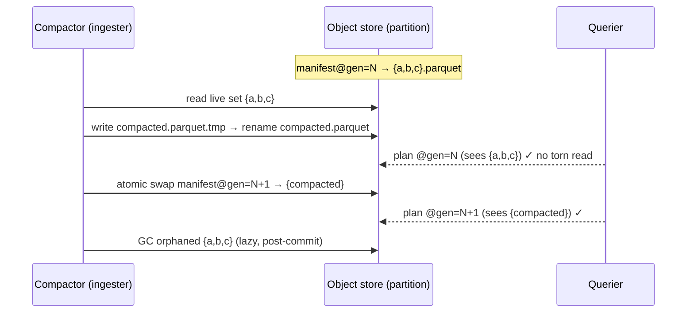

# RFC 0009 — Background compaction: small-file consolidation

> **Amendment (2026-10-16, #1027, maintainer-approved) — planning reads a
> tenant once, not every partition.** Candidate planning
> (§3.3) lists each tenant's data prefix once, recursively, and decides
> every partition from that listing. It reads a partition's manifest only
> when the listing shows two or more committed `*.parquet` objects there.
> A settled partition (one live file) then costs no request of its own, so
> a sweep's planning cost follows the objects a tenant holds (about 1,000
> per listing page), not the hours it has retained. The candidate
> predicate is unchanged; only the reads it is computed from change. No
> state is persisted or cached. Adds the in-place note in §3.3, scenarios
> RFC0009.8–.12 (§5), their test map (§6), the alternatives and open
> questions (§7) and the history (§9). Erasure and the graph backfill keep
> walking every hour partition, so they are unaffected (RFC0009.12). The
> accepted text below is left as written and the frontmatter stays
> `accepted` for the seven original criteria. The new scenarios were
> approved with the amendment and move through `red` and `green` with
> their tests. Refs #1019 (item 2). Records a pre-existing gap found while
> drafting it: a late write into an already-compacted partition is not
> re-flagged (#1026; §3.3 note, §7).

> **Amendment 2026-10-16 — late writes stay live (`drafted`, pending
> maintainer approval).** A record whose timestamp falls in an hour
> partition that was already compacted is written as a new
> `<uuidv7>.parquet` that the manifest does not name, so today it is
> invisible to every reader and `gc_orphans` deletes it the next time the
> partition is consolidated (#1026). The same happens to every flush into
> the *current* hour after an erasure, because an erasure rewrites every
> partition of the tenant and leaves a manifest in each. This amendment
> changes what the manifest records: it names the **compacted files that
> are live** and the **flush files a committed compaction consumed**, and
> every other flush file is live. A flush file can then be deleted only
> after a won commit has copied its rows, whatever crashes or races
> happen, and the writer's flush path is unchanged. Adds the in-place
> notes in §3.3 and §3.4, the alternatives in §4, scenarios
> RFC0009.13–.23 (§5), their test map (§6), the open questions (§7) and
> the history (§9), plus an in-place note in RFC 0047 §3.6 on erasure.
> **Breaking for the persisted layout:** a manifest written before this
> amendment is rejected, with no dual-read (§3.4 note). The accepted text
> below is left as written; the new scenarios are `drafted` until the
> maintainer approves them. Refs #1026.

> **Status: `accepted` (2026-08-25, maintainer sign-off).** Terminal —
> the completed-backlog batch flip; thesis-gates passed at `validated`.
>
> **Status note.** **`validated`** (2026-06-15) — the RFC0009.7 D2/D3/B2-post
> benches were measured authoritatively on `baseline-8vcpu-32gib`
> (`benchmarks.md` §9.7, git `4d52288`): **D3** PASS (a band-scale compaction
> output lands at 456.7 MiB, IN the 256 MiB–2 GiB H4 band, 0% under 128 MiB);
> **D2** compaction throughput 166.8 MiB/s single-partition (≫ any
> per-partition seal rate → backlog drains); **B2-post** query latency
> 12.78 ms → 2.10 ms (≈6.1×) as 32 files / row groups collapse to 1. The
> sustained-ingest soak (D2's literal one-hour window at D1's rate) and D1
> itself remain unrun — the throughput is the RFC0009.7 D2 measure, not that
> soak. The prior `green` status (flipped earlier the same day) rested on
> every RFC0009 §5 acceptance criterion having a live, passing test: **.1**
> small-file count collapses
> (`rfc0009_1_*`), **.2** row conservation (`compaction_conserves_every_row`
> proptest), **.3** atomic publish / no torn read (`atomic_publish_…` +
> the `ourios-querier` `rfc0009_3_*` manifest tests), **.4** crash safety
> (`rfc0009_4_*` — `gc_orphans` reclaims orphans, reads stay at a clean
> generation), **.5** tenant/partition isolation (`rfc0009_5_*` — a
> mis-partitioned input aborts on the §3.9 row-vs-path check), **.6**
> union-schema merge across an amendment (`rfc0009_6_*`). The atomic-publish
> protocol (§3.4) is the per-partition manifest + atomic generation swap;
> the querier resolves live files reader-first (glob-fallback when absent);
> the runner lives in `ourios-ingester` (`run_sweep`/`Compactor`) with the
> §3.6 OTel metrics + audit event.
>
> **RFC0009.7 — measured.** The D2/D3 `criterion` benches (compaction
> throughput, small-file size band) + the post-compaction B2 re-run live in
> `ourios-bench`'s `compaction` bench — CI-indicative via
> `compaction-bench.yml`, authoritative on `baseline-8vcpu-32gib` in §9.7.
> Its *structural* half (file count falls under compaction, every row
> conserved) is also pinned deterministically by RFC0009.1 /
> `compaction_conserves_every_row`.
>
> **Open follow-ups (§7, post-`validated`):** the full D2 sustained-ingest
> soak (backlog-returns-to-zero in a one-hour window at D1's rate) + a
> measured D1; late-arriving data re-flagging an already-compacted partition
> (the manifest is authoritative, so a new write into such a partition must
> be picked up by the candidate scan / folded into the manifest — confirm
> `plan_candidates` covers it); the S3 atomic-swap primitive + single-writer
> lease for object storage (local FS uses `rename`); and the RFC 0004 cadence
> defaults.

## 1. Summary

Ourios's writers land many small Parquet files per tenant per hour
(one per writer flush / time-rotated partition; `docs/hazards.md`
H4). This RFC introduces a **background, per-tenant, per-partition
compaction** pass that consolidates the small `*.parquet` files of a
*sealed* partition into one (or few) files inside the RFC 0005 §3.5
size targets, **without changing a single stored row** and **without
any query ever seeing a row twice or missing one**. Compaction reuses
the existing `ourios-parquet` `Reader`/`Writer` and the atomic-publish
convention (write to `*.parquet.tmp`, commit by rename); the live set
of a partition is named by a small per-partition **manifest** so the
commit is a single atomic object swap. It is the mitigation for
hazard H4 and the lever the RFC 0007 §6 / PR #92 B2 bench identified:
query latency there is dominated by *per-file footer reads*, not data
scanning, so fewer/larger files is the next query-latency win.

## 2. Motivation

### 2.1 The small-file problem is now measured, not theoretical

`docs/hazards.md` H4 predicted it; the B2 latency bench
(`crates/ourios-bench/benches/b2.rs`, RFC 0007 §6, landed in PR #92)
measured it. With result size held constant while the corpus grows
1×/10×/50×, query latency grew **sub-linearly but not flat** (~0.95 ms
→ ~1.55 ms → ~4.36 ms). The structural B2 test
(`rfc0007_2_template_exact_work_scales_with_result_not_corpus`) proves
the *scanned* row groups and bytes stay flat; the residual wall-clock
growth is per-file footer/metadata reads, because file count scales
with corpus. Compaction is the direct lever on that residual: collapse
N small files' N footer reads into one.

### 2.2 RFC 0005 explicitly deferred it here

RFC 0005 §3.5 says the writer's job is to "land at the bottom of [the
file-size] range or below on its own … compaction is deferred," and
§4.5 parks background compaction as "a post-MVP RFC." Two writer
behaviours guarantee small files even at steady state and so *require*
a sweeper: (a) **time-rotated partitions** — an hour partition that
receives a trickle of late or low-volume traffic produces a sub-128
MiB file; (b) **end-of-day audit files** (RFC 0005 §3.4) are
inherently small. H4's detection threshold ("fewer than 5 % of files
below 128 MiB at steady state") cannot be met by writer sizing alone.

### 2.3 Why at this layer

Compaction is a **write-path / storage** concern, not a query-path
one: the querier (RFC 0007, hazard §4.6) must stay a pure reader, and
the WAL→Parquet flush sizing (RFC 0005/0008) is a separate mechanism
(it sizes files *as they are first written*; this RFC re-consolidates
files *already published*). Doing it as a background pass keeps it off
the ack-latency hot path (WAL-before-ack, `CLAUDE.md` §3.4 is
untouched).

## 3. Proposed design

### 3.1 Scope

**In scope.** Background consolidation of the published, committed
`*.parquet` data files of a single sealed partition
(`data/tenant_id=<enc>/year=YYYY/month=MM/day=DD/hour=HH/`, the
RFC 0005 §3.4 Hive layout) into one or a few files meeting RFC 0005
§3.5 size targets, preserving every stored row exactly. The same mechanism applies to the audit-event series
(`audit/…`, day-granular).

**Out of scope.** WAL→Parquet flush sizing (RFC 0005/0008);
retention/expiry/TTL (no compaction-driven deletion of *data* — only
of inputs it has just rewritten); cross-partition or cross-tenant
merges; re-mining or re-templating (compaction copies rows, it does
not touch the miner); query-side caching.

### 3.2 Where it runs

A background task hosted in the **ingester** role (it already owns the
write path, the bucket credentials, and per-tenant context), with its
own bounded concurrency knob so it never starves ingest. The
compaction logic itself is a new `compaction` **module in
`ourios-parquet`** (it is Parquet-file manipulation — read many via
`Reader`, write one via `Writer`); no new crate. Driving it from a
dedicated `compactor` role is a deployment-scaling evolution captured
in §4, not an MVP requirement.

### 3.3 What is eligible: sealed partitions

Compaction only ever touches a **sealed** partition — one no longer
receiving writes — so it never races an active writer for the same
input set. A data partition (`…/hour=HH/`) is sealed once wall-clock
time passes the end of its hour plus a `compaction_grace` margin
(default 15 min, tunable per RFC 0004) that absorbs late-arriving
records. A sealed partition is a **candidate** when it has more than
`compaction_min_files` files (default 4) **or** holds files below
128 MiB. This is a **partition-local trigger heuristic** — distinct
from H4's *tenant-level* detection metric (the per-tenant file-size
histogram / "fewer than 5 % of files below 128 MiB at steady
state", §3.6), which is the cluster signal compaction's job is to
keep satisfied. Late data that
arrives after a partition is compacted lands as a new small file and
re-flags the partition as a candidate — compaction is idempotent and
re-runnable (§3.5).

> **Amendment (2026-10-16, #1027, maintainer-approved) — how the
> candidates are read.**
> The predicate above is unchanged. What changes is the reads it is
> computed from, because planning had become the sweep's dominant cost
> (#1019: about one listing and one manifest read per retained hour
> partition, at about 55 ms each, every sweep, growing with history and
> not with the work there is).
>
> **Before.** For each tenant, a delimiter walk enumerates the
> `year=/month=/day=/hour=` prefixes. Then, for every sealed partition,
> one `GET manifest.json` (a 404 when there is none) and one listing of
> the partition.
>
> **After.** For each tenant, the planner makes **one recursive listing**
> of `data/tenant_id=<enc>/` (the backend pages it, 1,000 keys per page on
> S3). It groups the listed keys by hour partition, parsing each Hive
> segment in the canonical zero-padded form as today (a non-canonical
> segment is skipped), and keeps only keys that sit directly in a
> partition. Partitions are visited oldest first. For each sealed
> partition, with *C* the committed `*.parquet` objects listed there and
> their sizes:
>
> 1. **|C| < 2** — not a candidate, and no further request. The live set
>    is a subset of *C* whatever a manifest says, so fewer than two
>    listed files means fewer than two live files. This covers the
>    settled partition (one consolidated file and its manifest), a lone
>    small file, and a partition holding only a manifest or `*.tmp`
>    objects.
> 2. **|C| ≥ 2, no `manifest.json` listed** — the live set is *C* (the
>    glob fallback). Decided from the listing; no manifest read.
> 3. **|C| ≥ 2, `manifest.json` listed** — one `GET manifest.json`; the
>    live set is *C* restricted to the names it lists, as today.
>
> The candidate test is then the one above: at least two live files, and
> either more than `compaction_min_files` or one below the small-file
> size. The result is the same as the per-partition reads would give on
> the same objects (RFC0009.9). The listing replaces those reads; it does
> not summarise them, so there is nothing to persist, invalidate or keep
> consistent between compactor processes.
>
> **Visibility timing changes slightly.** The per-partition reads looked
> at each partition when the walk reached it, so a write that landed
> before then was seen in the same sweep. Now the tenant is read once, at
> the start of its planning: a write that lands after that listing waits
> for the next sweep, even if the partition comes later in the walk. The
> delay is at most one sweep interval. A late write is never lost and
> never skipped for good: every sweep lists the tenant afresh
> (RFC0009.10).
>
> **Erasure and backfill are unaffected.** Only consolidation planning
> changes. The RFC 0047 §3.6 erasure pass and the RFC 0048 graph
> backfill still enumerate every hour partition of the tenant through
> `hour_partitions` (`compactor/erasure.rs`, `compactor/backfill.rs`) and
> visit each one. They never use the candidate planner. A settled
> single-file partition, which the planner skips without a read, is
> still rewritten by an erasure whose rows it holds (RFC0009.12).
>
> **Cost.** Per tenant per sweep: one logical listing, served as
> ⌈objects ÷ 1,000⌉ page requests on S3, plus
> one manifest read per sealed partition that holds two or more committed
> files and a manifest. A settled partition costs nothing beyond its two
> keys in the listing. At the H4 steady state of one file and one
> manifest per hour, a year of history is about 17,500 keys, or 18 pages.
> The listing is held in memory while the tenant is planned: about 100
> bytes per key, so a few MB per year of history, released before the
> tenant's partitions are compacted.
>
> **Late writes into a compacted partition (#1026).** The sentence above
> ("late data that arrives after a partition is compacted … re-flags the
> partition") does not hold today, and this amendment does not change
> that. Once a partition has a manifest, the manifest is the live set
> (§3.4). A late writer's file is not in it, so readers, the planner and
> `visit_partition_rows` ignore it, and `gc_orphans` would delete it as
> an orphan. Under this amendment such a partition falls under case 3 (the
> late file makes |C| ≥ 2), so it is read every sweep, and still not
> selected. Fixing it changes the manifest contract and is left to its
> own amendment (§7).

> **Amendment 2026-10-16 (`drafted`) — late writes re-flag the partition
> again.** With the §3.4 late-write note, the sentence above holds as
> written. A late flush file in a compacted partition is live, so the
> partition has two live files (the compacted one and the late one), and
> a late file below the small-file size makes it a candidate. The
> listing planner above needs one change: a committed `*.parquet` is now
> either a flush file or a compacted file (§3.4 note), and in case 2 (no
> manifest) only the listed flush files are live. Case 1 still holds,
> because the live set is still a subset of the listed files, and case 3
> applies the §3.4 note's live-set rule instead of "*C* restricted to the
> manifest's names". RFC0009.10's second arm changes from "read, not
> selected" to "selected" (RFC0009.13).

### 3.4 The atomic-publish protocol — per-partition manifest

A query (RFC 0007) plans over a partition by enumerating its committed
`*.parquet` files. If compaction publishes the consolidated file
*before* deleting its inputs, a concurrent query double-counts; if it
deletes inputs first, a query misses rows. Object storage (the source
of truth, `CLAUDE.md` §3.6) offers no atomic multi-object operation,
so a glob-the-directory reader **cannot** be made correct under
compaction.

**The commit mechanism is a per-partition manifest.** Each partition
carries a small `manifest.json` naming the **live set** of data files
(UUIDv7 names) plus a monotonically increasing generation number. The
read path (RFC 0007) resolves a partition's files through the
manifest, not a raw glob; absence of a manifest means "glob all
`*.parquet`" — so pre-compaction partitions and the current querier
keep working, and the reader gains manifest support *before* any
compactor writes one (the reader-first sequencing in §7). Compaction:

1. reads the live set, writes the consolidated `*.parquet.tmp`;
2. `rename`s it to its committed `*.parquet` name (still not
   referenced by any manifest, so invisible to queries);
3. writes `manifest.json.tmp` naming *only* the new file at
   `generation + 1`, and **atomically swaps** it into place (single-
   object rename / conditional put) — this is the commit point;
4. lazily deletes the now-orphaned input files (a crash here leaves
   harmless orphans that a GC sweep reclaims; correctness already
   committed at step 3).

A query reads a consistent generation: either the pre-compaction set
or the post-compaction set, never a mix (RFC0009.3). This is the
Iceberg/Delta "atomic metadata swap" idea reduced to one flat file per
partition — deliberately *not* a full table format; the generation-
subdirectory and glob-the-directory-reader alternatives were weighed
and rejected in §4.



This protocol is an interaction with **RFC 0007** (the querier must
read through the manifest) and a small extension to **RFC 0005** (the
manifest is a new per-partition artifact — additive, optional,
back-compatible). Both are recorded as resolved decisions in §7.

> **Amendment 2026-10-16 (`drafted`) — late writes stay live (#1026).**
>
> **The defect.** The receiver derives a record's partition from its own
> timestamp (`PartitionKey::derive`), with no admission window, so a
> record can land in any old hour at any time. The `Writer` puts a new
> `<uuidv7>.parquet` and never touches `manifest.json`. Once a partition
> has a manifest, the manifest above is the whole live set, so the late
> file is invisible to the querier (`resolve_live_files`,
> `resolve_live_keys`), the planner, `visit_partition_rows` and the
> erasure rewrite, and `gc_orphans` deletes it the next time the
> partition is consolidated. The same rule hides a flush that lands
> between a compaction's listing and its commit, and, because the RFC
> 0047 §3.6 erasure rewrites every hour partition including the current
> one, every flush into the current hour after an erasure. The data was
> acknowledged (WAL-before-ack, `CLAUDE.md` §3.4) and object storage is
> its truth (§3.6), so this is a durability defect, not a freshness one.
>
> **The fix: the manifest records what compaction consumed, not the whole
> live set.** It rests on telling the two writers' files apart by name.
>
> - A **flush file** is what the receiver's `Writer` puts:
>   `<uuidv7>.parquet`, as today. The flush path does not change.
> - A **compacted file** is what a compaction (or an erasure rewrite)
>   writes: `<uuidv7>.g<N>.parquet`, where *N* is the manifest
>   generation the compaction will commit at. Only the compactor writes
>   this form.
>
> The manifest becomes:
>
> ```json
> {"format": 2,
>  "generation": 7,
>  "files": ["0199f2c4-….g7.parquet"],
>  "consumed": ["0199f1a0-….parquet", "0199f1b3-….parquet"]}
> ```
>
> `files` lists only compacted files; `consumed` lists only flush files.
> `consumed` is append-only: a commit adds names to it and never removes
> one. The **live set** of a partition is
>
> - every compacted file named in `files`, plus
> - every listed flush file that `consumed` does not name.
>
> With no manifest, `files` and `consumed` are both empty, so the live set
> is every listed flush file (the glob fallback, unchanged), and a
> compacted file is never live without a manifest that names it. One
> function computes this rule, shared by the querier's two resolvers,
> `live_file_keys`, `is_candidate`, `visit_partition_rows` and
> `gc_orphans`.
>
> **Commit protocol (replaces steps 1–4 above).**
>
> 1. Read `manifest.json` and its `ETag` (absent ⇒ generation 0, empty
>    lists). Then list the partition. The inputs are the live set by the
>    rule above.
> 2. Write the output as `<uuidv7>.g<N+1>.parquet`. Nothing names it, so
>    no reader sees it. The bootstrap manifest of today's step is no
>    longer needed: an unnamed compacted file is invisible with or
>    without a manifest.
> 3. Commit `{format: 2, generation: N+1, files: outputs, consumed:
>    consumed ∪ flush inputs}` with the existing conditional PUT
>    (`If-Match` on the `ETag`, or create-if-absent at generation 0) on
>    S3, or the local atomic overwrite (RFC0019.7). This is the commit
>    point. `outputs` is **every** file the compaction wrote, each named
>    `….g<N+1>.parquet`. Today `compact_sorted` writes exactly one (`files:
>    vec![consolidated]`), so `outputs` has one entry. A compaction that
>    splits its output into the "one or few" files §3.1 allows names all of
>    them in this one commit. Compacted inputs drop out of `files`.
> 4. On a won commit, delete the inputs, best effort (unchanged). An
>    input is never deleted before the commit that names every output has
>    won. On a lost commit, delete every output, best effort; any that
>    survive are orphans by the generation rule below.
>
> **Why a late file is never lost.** A flush file becomes invisible only
> by entering `consumed`, and it enters `consumed` only in a won commit
> whose output was written from it. A file that lands after step 1's
> listing is not an input, so the commit does not consume it and it stays
> live. A file that lands after the commit is live by the same rule, and
> it makes the partition a candidate again (§3.3 note). Nothing compares
> clocks: the rule depends only on names and on the manifest's contents.
> Because `consumed` is never trimmed, a flush file whose put is retried
> after its first copy was consumed and deleted reappears under a consumed
> name and stays hidden; its rows are already in the output.
>
> **Orphans (replaces `gc_orphans`'s rule).** With manifest generation *G*:
>
> - a flush file is an orphan **only if `consumed` names it**. A flush
>   file that the manifest does not mention is live, never an orphan;
> - a compacted file `….g<N>.parquet` is an orphan if `files` does not
>   name it **and** *N* ≤ *G*. Its commit at generation *N* either won
>   (and a later commit has since replaced it) or lost to another commit
>   at *N*. If *N* > *G*, a compaction may still be about to commit it,
>   so it is kept;
> - `*.parquet.tmp` is an interrupted local put, as today.
>
> This is also what makes a lost CAS safe. `compact_sorted` deletes its
> unnamed output on a lost commit, but only best effort. A leftover
> output is a compacted file whose generation the winner has already
> reached, so it is never live and the next GC reclaims it. It cannot
> pass for a late file, because late files are flush files.
>
> **Crash interleavings.** Each case leaves every acknowledged row in
> exactly one live file:
>
> | Crash or race | What is left | Read as | Reclaimed by |
> |---|---|---|---|
> | Writer dies before its put completes | nothing on S3; a `*.parquet.tmp` locally | the WAL replays the batch (RFC 0008) | GC (`.tmp`) |
> | Writer's put lands during a compaction, after step 1's listing | an unconsumed flush file | live, before and after the commit | never; it is compacted later |
> | Compactor dies before step 3 | an unnamed output at *N*+1 > *G* | the inputs, unchanged | GC once a later commit reaches *N*+1 |
> | Compactor dies after step 3, before or during step 4 | consumed inputs not yet deleted | the output only | GC (`consumed`) |
> | Compactor loses the CAS, and its output delete fails | an unnamed output at *N*+1 ≤ *G* | the winner's generation | GC |
> | Two compactors race at generation *N* (S3) | one wins, the other is a lost CAS | the winner's generation | as above |
>
> The local backend has no conditional update, so its commit stays
> last-writer-wins (RFC0019.7) and it still assumes one compactor per
> store, as the chart's single-replica compactor already guarantees. A
> second local compactor is unsafe today and remains unsafe (§7).
>
> **Reader order.** A reader lists the partition first and reads the
> manifest second, which is the order both querier resolvers and the
> listing planner already use. That order cannot tear: a flush file the
> listing shows and the later manifest consumed is excluded, and its rows
> are in a compacted file that manifest names. The reverse order could
> miss rows, because an old manifest plus a listing taken after the
> inputs were deleted shows neither. The compactor reads the manifest
> first, but its CAS rejects any commit based on a stale read.
>
> **A resolution can still go stale before the files are opened.** The
> store-backed resolver (`live_keys_from_listing`) fetches only the
> manifests its listing shows, to avoid a 404 `GET` for every partition
> that has none. So if the listing comes before a partition's **first**
> commit, the resolver applies the glob fallback to flush names that the
> commit then consumes and deletes. The same happens to a compacted file
> named by a manifest that a later commit replaces and deletes. In both
> cases the stale key is one whose rows a committed file already holds,
> because a data file is deleted only after a won commit replaces it.
> Opening that key returns not-found and never silently returns fewer
> rows. The querier therefore treats a not-found on a resolved data key as
> a stale resolution:
>
> 1. It discards the plan, resolves the file set again (a fresh listing,
>    then the manifests it shows), and re-runs the query.
> 2. It does this at most twice more (three attempts in all), and only
>    while no row has been sent to the caller.
> 3. After that, or once rows have been sent, the not-found surfaces as
>    a storage error that names the key. Rows are never returned short.
>
> The local resolver reads each partition's manifest at resolution time,
> so it sees a first manifest. It meets the same not-found only when a
> commit deletes files between resolution and execution, and it takes the
> same retry. A fresh manifest `GET` for every unmanifested partition
> would also close the first-commit case. It is not chosen, because it
> brings back the per-partition 404 that the listing avoids, for a race
> that needs a commit and its deletes to land inside one query's
> resolution (RFC0009.18).
>
> **Manifest size.** `consumed` grows by the flush files compacted into
> the partition: a few dozen names per hour at today's flush cadence,
> about 50 bytes each. Trimming it is deliberately not offered; a trim
> would reopen both the reader-order race and the retried-put case above
> (§7).
>
> **Layout impact (breaking).** The manifest gains `format` and
> `consumed`, `files` holds only `….g<N>.parquet` names, and compaction
> output is renamed. A manifest without `"format": 2` is rejected with a
> typed error that names the partition: no dual-read and no migration
> tool, per the pre-production policy. In an old manifest the unnamed
> `*.parquet` files are inputs left behind, late files and lost-CAS
> outputs, all with the same name form, so no rule can tell them apart.
> Pre-production stores start from an empty `data/` prefix. The
> implementation PR carries a `!` and a `BREAKING CHANGE` footer. RFC 0005
> needs no amendment: the manifest stays an optional per-partition
> artefact owned here, and Parquet files and their schema are unchanged.

> **Amendment 2026-10-16 (`drafted`) — erasure covers late files (RFC
> 0047 §3.6).** Today an erasure rewrites only the files a manifest names.
> Once late files are live, an erased conversation's rows could reappear
> from one, so the erasure's rows phase must account for every flush file
> that can hold rows acknowledged before the request. Three cases:
>
> 1. **A late file that landed before the erasure.** It is live, so the
>    rewrite's inputs include it and the commit consumes it. Nothing new is
>    needed beyond the live-set rule. (Today this file is hidden, skipped by
>    the rewrite, and would surface with the erased rows if it were made
>    visible without this rule, so the rule and the erasure change land
>    together.)
> 2. **A file that lands, or is committed, while the rows phase runs.**
>    The rows phase records, for each partition it visits, a **checked
>    generation**:
>
>    - after a won erasure commit, the generation that commit won; the
>      partition's live set is then exactly that commit's compacted files;
>    - when the rewrite finds no live input and commits nothing, the
>      generation it observed. That is 0 when there is no manifest, as in a
>      partition holding only `*.parquet.tmp` objects or nothing live at
>      all.
>
>    An empty partition that stays empty is therefore settled, not
>    "changed" forever. Before the marker advances to
>    `tuples`, the rows phase runs a **confirming pass**: it re-lists the
>    tenant and reads the manifest of every partition. A partition must be
>    rewritten again, with the same drop filter, if it holds a live flush
>    file, or if its generation is no longer the one recorded for it. A
>    generation that moved on means another commit landed since: an
>    ordinary consolidation by a second compactor (S3 allows more than
>    one) may have folded a late file holding the conversation's rows into
>    a new compacted file, which then shows no live flush file. Each
>    rewrite or empty check records its checked generation. A partition the
>    phase has not visited yet (it was created during the phase) has no
>    checked generation, so it is visited.
>    The pass repeats until a pass finds nothing to rewrite, for at most 8
>    rounds, the bound the tuple phase already uses. If partitions are
>    still changing after that, the marker stays in `rows` and the next
>    sweep runs the whole rows phase again. The pass may drop rows of the
>    conversation that were acknowledged after the request. That is
>    over-erasure, which is the safe direction for an erasure, and it is
>    limited to the rows phase. A confirming pass costs one listing plus
>    one manifest `GET` per partition of the tenant, small next to the
>    rewrite of every partition that the erasure already does.
> 3. **A row acknowledged before the request but published after the
>    confirming pass has passed its partition.** The receiver publishes from
>    its WAL on its own cadence, in another process, and nothing tells the
>    compactor that the receiver has published every row acknowledged
>    before the request. A publish can therefore land after the last
>    confirming pass has checked its partition but before the marker
>    advances to `tuples`. It can also land later still: after a long flush
>    backlog, or after a restart that replays the WAL (RFC 0008). Later
>    sweeps retry only the tuple deletion, so such a row stays. Neither the
>    8 rounds nor any delay closes this, because the race is with an
>    unbounded publish. The rows phase does not start until the marker is
>    older than `erasure_settle`, measured as the store's `LastModified` of
>    the marker against the compactor's clock. The default is twice the
>    receiver's maximum flush interval plus `compaction_grace`. That makes
>    the window rare in normal operation: a pre-request row would have to
>    be still unpublished `erasure_settle` after the request. It does not
>    make the window empty. **This is the recorded residual (§7, decision
>    D3).** RFC 0047 §3.6 scopes erasure to "the rows durable at the
>    rewrite", and this amendment states the scope as: rows **published**
>    before the last confirming pass checks their partition. Closing it
>    needs a fence that the compactor can read across processes. The
>    candidates, none specified here, are:
>    - a per-receiver, per-tenant publication frontier exported to the
>      store, which the rows phase waits on until every live receiver has
>      published past the marker's creation. RFC 0055's `PUBLISHED`
>      frontier is that watermark, but it is node-local and RFC 0055 is
>      still `drafted`;
>    - receivers that read pending markers and drop the conversation's rows
>      at publish. This needs a receiver membership list, so the compactor
>      knows that every receiver has seen the marker.
>
> **The rewrite is safe on unsealed partitions now.** An erasure keeps
> rewriting every hour partition, including the current one (RFC0009.12).
> Under the live-set rule, a flush into a partition after its erasure
> rewrite is live. Before this amendment it was hidden by the manifest
> the rewrite left behind (RFC0009.21).
>
> **Graph tuples (RFC 0047 §3.3, RFC 0048 §3.4).** The emitter has three
> feeds: the receiver's flush cadence (every published batch, late files
> included, so a late row's tuples are written today even while the row
> is hidden), the compaction pass's `observe` hook, and the backfill
> through `visit_partition_rows`. Under this amendment the last two also
> see late rows, because those rows are live. All three write with
> `on_duplicate = ignore`, so this amendment adds no tuple that would not
> otherwise exist. That does not make the feeds free of races with
> erasure. A separate known residual exists today, independent of late
> data: with more than one compactor, a sweep's buffered `observe`
> tuples can be written after another sweep erased the conversation
> (#1034, §7 next to D3). The OpenFGA model and the tuple shapes
> do not change. The OpenFGA documentation assistant (2026-10-16)
> confirmed the one point that matters for erasure: `on_duplicate =
> ignore` skips only a tuple that **currently exists**, so a tuple that an
> erasure deleted is created again by any later write of it. Two things
> follow:
>
> - The erasure rewrite still passes no `observe` hook, so it never
>   re-emits the tuples it is about to delete. The confirming pass in case
>   2 uses the same rewrite, so it does not re-emit them either.
> - In case 3, a row published after the last confirming pass re-creates
>   its tuples at flush cadence (or at the next consolidation through
>   `observe`), and both row and grant are visible again. This is the same
>   residual as case 3, on the graph side.

### 3.5 Correctness, idempotency, crash safety

- **Row conservation.** Compaction preserves every **row value**
  exactly — including the raw `body` bytes — but does *not* promise
  byte-identical Parquet files: the physical encoding may differ
  (row groups re-packed to the §3.5 sizes, compression re-applied,
  rows possibly reordered within the partition). The logical
  guarantees hold: same RFC 0005 schema, same partition ⇒ row-vs-
  path validation §3.9 still holds; bit-identical *body*
  reconstruction §3.3 is preserved because rows are copied, never
  re-mined. Total row count and per-`template_id` counts are
  invariant across a compaction (RFC0009.2).
- **Idempotency.** Re-running compaction on a partition with a single
  already-large file is a no-op (not a candidate per §3.3).
- **Crash safety.** The only commit point is the atomic manifest swap
  (step 3). A crash before it leaves the prior generation
  authoritative — no acknowledged data lost (mirrors the WAL
  crash-recovery discipline, `CLAUDE.md` §3.4). Temp files and
  post-commit orphans are reclaimed by an idempotent GC sweep.
- **Heterogeneous input schemas.** Inputs spanning a schema amendment
  (some files with an added OPTIONAL column) merge to the union schema
  and stay readable per RFC 0005 §3.9 (the same forward-compatible
  read RFC0007.4 already tests).

### 3.6 Audit + observability

#### Audit event

Every committed compaction emits an **audit event** to the RFC 0005
§3.7 audit stream — the "nothing happens silently to stored data"
stance applied to file lifecycle (`CLAUDE.md` §3.1), the same way a
template merge is audited. The event records the partition, the input
file set, the consolidated output file, the row count (which must be
conserved, RFC0009.2), and the committed manifest generation.

> **Open question (§7):** the existing audit schema (RFC 0005 §3.7) is
> shaped for *template* events — `event_kind` is a bounded ordinal
> mapping with no compaction member, and the template-specific columns
> (`old_template`, `positions_widened`, …) are **non-nullable**. A
> compaction event can reuse the common envelope (`tenant_id`,
> `timestamp`, `event_kind` / `event_type`, `reason`) but (a) needs a
> new `compaction` member in the `event_kind` mapping and (b) has no
> applicable value for the non-nullable template columns, nor a place
> for the file set / generation. This is an implementation detail to
> settle when the compaction audit-emit code lands — not a design
> blocker, so it does not gate `red` (tracked in §7). The two routes:
>
> - **structured `reason`** — carry the file set / generation as a
>   structured `reason` payload. Avoids new columns, but still needs
>   the `event_kind` member *and* forces placeholder values into the
>   non-nullable template columns (or making them nullable, which is
>   itself a schema change), so "no schema change" is not quite free.
> - **additive OPTIONAL columns** — add OPTIONAL compaction columns
>   and relax the template columns to OPTIONAL (an RFC 0005 §3.8
>   additive, back-compatible amendment); old readers ignore unknown
>   columns per RFC 0005 §3.9.
>
> The non-nullability tilts this toward the additive route; settle it
> against RFC 0005 §3.7 when that code lands, not here.

#### Metrics (OpenTelemetry semantic conventions)

Instrumented as **OpenTelemetry meters** and exported via the **OTel
SDK's OTLP metric exporter** (push over OTLP to a collector /
endpoint) — the OTel SDK pipeline end-to-end. No `prometheus` client
crate and no Prometheus scrape endpoint (maintainer direction,
2026-06-03, superseding the earlier `opentelemetry-prometheus`
exporter note in roadmap §5; any Prometheus compatibility is a
downstream collector concern, not Ourios's). The names below follow
the OTel metric-naming guidelines — dotted/namespaced, no
`_total`/unit suffixes, UCUM units (including UCUM curly-brace
**annotations** such as `{sweep}` / `{file}` for dimensionless counts,
which annotate the unit `1`), dimensions as attributes — and are
exported **verbatim** over OTLP (no exporter-side name mangling).

| Metric | Instrument | Unit | Attributes | Source |
|---|---|---|---|---|
| `ourios.compaction.sweeps` | Counter | `{sweep}` | `ourios.compaction.result` | RFC 0009 §3.2 |
| `ourios.compaction.partitions` | Counter | `{partition}` | — | partitions consolidated |
| `ourios.compaction.files` | Counter | `{file}` | — | input files merged away (H4) |
| `ourios.compaction.rows` | Counter | `{row}` | — | rows rewritten (RFC0009.2) |
| `ourios.compaction.io` | Counter | `By` | `ourios.io.direction` | bytes read / written |
| `ourios.compaction.duration` | Histogram | `s` | `ourios.compaction.result` | sweep wall-clock |
| `ourios.compaction.orphan.files` | Counter | `{file}` | — | inputs left un-GC'd (`gc_failures`) |
| `ourios.compaction.backlog` | UpDownCounter | `{partition}` | `ourios.tenant` | sealed-but-uncompacted (lag) |
| `ourios.storage.parquet.file.size` | Histogram | `By` | `ourios.tenant` | **H4 detector** — alert when > 5 % of files < 128 MiB |

Attributes (namespaced per the conventions):

- `ourios.tenant` (string) — tenant id. Cardinality is bounded by the
  tenant count; on the per-file-size histogram it is the dimension H4
  detection needs ("*per-tenant* file-size histogram").
- `ourios.io.direction` (string, `read` | `write`) — mirrors
  `disk.io.direction`; one `io` counter with a direction attribute
  rather than two `_in`/`_out` metrics.
- `ourios.compaction.result` (string, `committed` | `noop` | `error`)
  — sweep / partition outcome (`noop` = candidate that consolidated
  nothing; `error` = a partition skipped per the resilient sweep).

The H4 "file-count grows sub-linearly with bytes" signal is a derived
alert over `ourios.storage.parquet.file.size` (count) and ingested
bytes, not a base metric.

> **Validation gate.** This set is the OpenTelemetry semantic-
> conventions **registry** at `semconv/registry/`, validated by
> `weaver registry check` in CI (the `semconv` job, a required check)
> — so the names/units/attributes stay spec-adherent and can't drift.
> Compaction is the first place these conventions are pinned; RFC 0001
> §6.8's Prometheus-style names get the same OTel-source treatment in
> its own amendment (roadmap §5).
>
> **Code generation.** Instrumentation does not hand-type these names:
> `weaver registry generate` renders the registry into a dependency-
> free leaf crate **`ourios-semconv`** (`const &str` per metric /
> attribute, mirroring upstream `opentelemetry-semantic-conventions`),
> which every instrumented crate depends on. The generator template
> lives at `templates/registry/rust/`; regenerate with the same command
> CI runs (`--future` matches `weaver registry check --future`):
>
> ```sh
> weaver registry generate rust crates/ourios-semconv/src \
>     -t templates -r semconv/registry --future
> cargo fmt -p ourios-semconv
> ```
>
> The same `semconv` CI job regenerates and fails on any diff (it also
> catches new untracked files), so the constants cannot drift from the
> registry. This new leaf crate extends the `CLAUDE.md` §7 layout; the
> commitment is blessed here, the same way `ourios-telemetry` was
> blessed in RFC 0001 §6.8.

## 4. Alternatives considered

- **No compaction (rely on writer flush sizing).** Rejected: §2.2 —
  time-rotated low-volume partitions and end-of-day audit files are
  small by construction, so H4's <5 % threshold is unmeetable without
  a sweeper, and PR #92 measured the latency cost.
- **Glob-the-directory reader, delete-after-publish (no manifest).**
  Rejected: object storage has no atomic multi-object op, so there is
  always a window where a query double-counts (publish-then-delete) or
  misses rows (delete-then-publish). §3.4.
- **Full table format (Apache Iceberg / Delta Lake).** Rejected for
  now: Pillar 1 commits Ourios to plain Parquet end-to-end (RFC 0005
  §4.6 rejects even a second *file* format); a full manifest-of-
  manifests, snapshot log, and schema-registry is far more machinery
  than one flat per-partition manifest needs. The atomic-swap idea is
  borrowed from them (§3.4); the bookkeeping is not.
- **Compaction in the querier.** Rejected: the querier is a pure
  reader (hazard §4.6); a read path that mutates storage breaks that
  contract and the multi-reader model.
- **Dedicated `compactor` role/binary.** A viable evolution for
  isolating compaction CPU/IO from ingest at scale; deferred — the
  MVP hosts it as a bounded background task in the ingester (§3.2),
  and the role split is a later, non-breaking change.
- **Generation subdirectories instead of a manifest** (`…/gen=K/`,
  querier reads the highest). Rejected: it leaks generation into the
  partition path (a second pruning axis the querier must learn) and
  complicates partition discovery; the flat manifest (§3.4) keeps the
  path stable and confines the change to one optional per-partition
  file. (This was the leading alternative; the manifest won on
  read-path simplicity.)

> **Amendment 2026-10-16 (`drafted`) — late writes (#1026).** Three fix
> directions were filed with the issue. The recommended design (§3.4
> late-write note) is a fourth. Each was weighed against the same
> requirements: a late file is visible to queries from the moment its put
> completes, it counts toward the candidate predicate like any other live
> file (so it is compacted once §3.3 selects its partition; two large live
> files below `compaction_min_files` stay unselected, as RFC0009.10
> states), it is never deleted as an orphan under any crash or lost CAS,
> the flush path
> stays as it is, and the design works with a writer and a compactor in
> separate processes (the chart's separate compactor Deployment) on S3
> and on the local backend.

- **(1) The writer appends its file to the manifest by CAS.** It keeps
  the manifest as the positive live set, and it is the runner-up.
  Rejected for four reasons:
  - It puts a manifest `GET` and a conditional `PUT` on every flush into
    a manifested partition (two S3 round trips, about 55 ms each), and
    those writes race the compactor's swap, so both sides need retry
    loops and the compactor's commit becomes a merge.
  - The local backend has no conditional update (`LocalFileSystem`
    rejects `PutMode::Update`). A receiver and a compactor in separate
    processes on one host would overwrite each other's manifest and lose
    the late file again.
  - Between the writer's put and its append, the file is unnamed and
    looks like an orphan. A GC in that window deletes it, and the append
    then names a missing file. Closing that needs an age gate on GC, which
    is a clock, and a WAL checkpoint held until the append, which is a
    change to the RFC 0052 publish barrier.
  - Every partition with no manifest needs a create-if-absent race
    between the writer and the compactor's bootstrap.
- **(2) A UUIDv7-time rule.** The manifest records its commit instant,
  and an unnamed `*.parquet` whose UUIDv7 time is later is live.
  Rejected. The UUIDv7 time comes from the receiver's clock and the
  commit instant from the compactor's, so a late file from a receiver
  whose clock runs behind counts as an orphan and is deleted. A
  compaction output, which also has a UUIDv7 name, that a compactor opened
  after a concurrent commit counts as live and double-counts its rows.
  That happens whenever `compact_sorted`'s best-effort delete of a
  lost-CAS output fails. Both failures are silent.
- **(3) The compactor folds unnamed files into the manifest after a
  settle delay.** Rejected. The data is invisible for the delay, and
  folding cannot tell a late file from an input a crashed compaction
  left behind or a lost-CAS output, since all three are unnamed
  `<uuidv7>.parquet`. Folding the wrong one double-counts rows. Telling
  them apart needs the flush/compacted name split, and with that split
  no delay is needed.
- **Recommended: (4) the manifest records what compaction consumed.**
  Flush and compacted files have distinct names, the manifest names live
  compacted files and consumed flush files, and every other flush file
  is live. The flush path does not change, there is no window of
  invisibility, and no clocks are compared. A compacted file's name
  carries the generation it was written for, so GC never touches an
  in-flight output, and a lost-CAS leftover can never be mistaken for a
  late file. The cost is a breaking manifest format and a manifest that
  grows with the flush files compacted into each partition (§3.4 note).

## 5. Acceptance criteria

> `Given / When / Then / And`; ids greppable from tests. These
> realise hazard H4 and the affected invariants.

- **RFC0009.1 — small-file count falls below the H4 threshold `[H4
  detection]`**
  - **Given** a sealed partition with many sub-128 MiB files
  - **When** compaction runs to completion
  - **Then** the partition holds files inside the RFC 0005 §3.5 size
    range, and at steady state fewer than 5 % of a tenant's files are
    below 128 MiB.

- **RFC0009.2 — row conservation `[§3.3 / data integrity]`**
  - **Given** any set of input files in a partition
  - **When** they are compacted
  - **Then** the multiset of stored rows is identical
    (total row count and per-`template_id` counts unchanged), and each
    row still reconstructs bit-identically (RFC 0005 §3.3).

- **RFC0009.3 — query atomicity (no double-count, no miss) `[H4 /
  RFC0007]`**
  - **Given** a query planned concurrently with a compaction of the
    same partition
  - **When** it executes
  - **Then** it observes exactly one generation's file set — every
    row exactly once — never a torn mix of pre- and post-compaction
    files.

- **RFC0009.4 — crash safety `[§3.4 discipline]`**
  - **Given** a compactor killed at any point
  - **When** the system recovers
  - **Then** no acknowledged row is lost: the partition reads as
    either the pre- or post-compaction generation, and orphaned
    temp/input files are reclaimable.

- **RFC0009.5 — tenant + partition isolation `[§3.7]`**
  - **Given** multi-tenant data
  - **When** compaction runs
  - **Then** it never merges files across tenants or across partition
    keys; a compacted file's rows all share the partition's
    `tenant_id` and time bucket (RFC 0005 §3.9 row-vs-path holds).

- **RFC0009.6 — forward-compatible merge `[§3.5 / RFC0007.4]`**
  - **Given** inputs spanning a schema amendment (some with an added
    OPTIONAL column)
  - **When** compacted
  - **Then** the output carries the union schema and reads without
    error per RFC 0005 §3.9.

- **RFC0009.7 — file count sub-linear in bytes `[H4 / benchmarks
  D3]`**
  - **Given** sustained ingest with compaction running
  - **When** bytes ingested grow
  - **Then** file count grows sub-linearly, and template-exact query
    latency (RFC 0007 §6 B2 bench) does not grow proportionally to the
    pre-compaction file count.

> **Amendment (2026-10-16, #1027, maintainer-approved) — planning
> cost.** RFC0009.8–.12 cover the §3.3 note on how candidates are read.

- **RFC0009.8 — a settled partition costs no request of its own `[H4 /
  #1019]`**
  - **Given** a tenant with many sealed partitions, each holding one
    committed `*.parquet` (some with a `manifest.json`, some without)
  - **When** its candidates are planned
  - **Then** none is selected, and planning makes exactly one logical
    recursive listing of the tenant's prefix: no request per partition
    and no `GET`. The backend may serve that listing as several page
    requests (1,000 keys per page on S3); the page count follows the
    tenant's object count, not its partition count.

- **RFC0009.9 — the selection is unchanged `[H4 / RFC0009.1]`**
  - **Given** any set of sealed and unsealed partitions, each with any
    number of committed files of any size, with or without a manifest
    naming any subset of them, and with orphans and `*.parquet.tmp`
    objects
  - **When** its candidates are planned
  - **Then** the selection, in order, is exactly what the per-partition
    reads (a manifest read and a partition listing for every sealed
    partition) select on the same objects.
  - **And** a partition whose listing holds two or more committed files
    and a manifest is selected or skipped by the manifest's live set,
    never by the listing alone.

> **Amendment 2026-10-16 (`drafted`, late writes) — RFC0009.9's oracle.**
> The comparison stays: the listing planner must select exactly what
> per-partition reads select on the same objects. Both sides change their
> live-set rule to the format-2 rule of the §3.4 late-write note. The
> oracle's per-partition read becomes "the compacted files the manifest
> names, plus the listed flush files it does not consume", replacing "the
> listed files restricted to the manifest's names". The generated
> fixtures are in the new layout:
>
> - flush files and `….g<N>.parquet` compacted files;
> - format-2 manifests whose `files` name any subset of the compacted
>   files and whose `consumed` names any subset of the flush files;
> - orphan compacted files with *N* ≤ *G* and in-flight ones with
>   *N* > *G*;
> - `*.parquet.tmp` objects.
>
> Under the old oracle, one compacted file plus an unconsumed small flush
> file was skipped; under the new one it is selected (RFC0009.13). The
> two-file non-candidate unit case stays, rebuilt as a manifest naming
> one compacted file plus an **orphan compacted file** (unnamed, *N* ≤
> *G*): two listed files, one `GET`, one live file, not selected.

- **RFC0009.10 — a late write into a settled partition is re-planned
  `[H4 / §3.3]`**
  - **Given** a sealed partition with no manifest and one committed file
    at or above the small-file size, which a planning pass did not select
  - **When** a writer later lands a second committed file in it, below
    the small-file size, and candidates are planned again
  - **Then** the partition is selected. (A late file at or above the
    small-file size leaves two large files, which §3.3 does not select
    until there are more than `compaction_min_files`; see
    `plan_skips_when_files_are_large_and_few`.)
  - **And** given a compacted partition (a manifest naming its one file)
    that receives a late file, the next pass reads its manifest rather
    than skipping it. Whether it is then selected is #1026's to decide;
    until then it is not, as today.

- **RFC0009.11 — planning keeps no state `[§3.6 / multiple compactors]`**
  - **Given** a store with sealed candidates
  - **When** candidates are planned, by one planner or by two
    independent ones over the same store
  - **Then** no object is written, and both select the same partitions.

- **RFC0009.12 — erasure still reaches a settled partition `[RFC 0047
  §3.6 / CLAUDE.md §3.7]`**
  - **Given** a sealed partition with one live file at or above the
    small-file size, which candidate planning skips, holding rows an
    erasure request matches
  - **When** a sweep runs the erasure
  - **Then** the partition is rewritten without the matching rows, and
    the other rows are kept.

> **Amendment 2026-10-16 (`drafted`) — late writes stay live.**
> RFC0009.13–.23 cover the §3.4 late-write note and the erasure note
> after it. They are `drafted` until the maintainer approves the
> amendment. RFC0009.13 replaces RFC0009.10's second arm.

- **RFC0009.13 — a late write into a compacted partition is read and
  compacted `[CLAUDE.md §3.4 / §3.6 / #1026]`**
  - **Given** a partition with two flush files (templates 1 and 2),
    compacted so that the manifest names only the output
  - **When** a third flush file (template 3, below the small-file size)
    lands in the same hour
  - **Then** the querier and `visit_partition_rows` return templates 1,
    2 and 3, and `plan_candidates` selects the partition.
  - **And** when the partition is compacted again, the output holds all
    three rows, the late file is consumed, and no row is counted twice.
  - **And** `gc_orphans` run at any point before that compaction leaves
    the late file in place.

- **RFC0009.14 — no unconsumed flush file is ever deleted `[CLAUDE.md
  §3.4 / RFC0009.4]`**
  - **Given** any interleaving of writer puts, compaction steps 1–4,
    lost CASes, failed deletes, crashes at each step, and `gc_orphans`
    passes over one partition
  - **When** the partition is read after every step
  - **Then** every row of every completed flush put is read exactly
    once, and the only flush files ever deleted are ones a won commit's
    `consumed` names.

- **RFC0009.15 — a flush that lands during a compaction stays live
  `[RFC0009.3]`**
  - **Given** a compaction that has listed its inputs and not yet
    committed
  - **When** a flush file lands in the partition and the compaction then
    commits
  - **Then** the committed manifest does not consume the new file, and
    reads before and after the commit both include its rows.

- **RFC0009.16 — a lost-CAS leftover never reads as live
  `[RFC0009.3 / RFC0009.4]`**
  - **Given** two compactions of one partition at generation *N* on a
    CAS backend, where the loser's delete of its output fails
  - **When** the partition is read, and then `gc_orphans` runs
  - **Then** the read returns the winner's generation only, without the
    leftover output, and GC deletes the leftover.

- **RFC0009.17 — GC keeps an in-flight output `[RFC0009.4]`**
  - **Given** a manifest at generation *G* and an unnamed compacted file
    written for generation *G* + 1
  - **When** `gc_orphans` runs
  - **Then** the file is kept. Once a commit reaches *G* + 1 without
    naming it, the next GC deletes it.

- **RFC0009.18 — reads do not tear between the listing and the manifest
  `[RFC0009.3]`**
  - **Given** a reader that has listed a partition and not yet read its
    manifest
  - **When** a compaction commits and deletes its inputs in between
  - **Then** the reader returns every row exactly once.
  - **And** given a partition with **no** manifest when the store-backed
    resolver lists it, when that partition's first commit creates the
    manifest and deletes the inputs before the query opens them, then the
    query re-resolves on the not-found and returns every row exactly once.
    It never returns fewer rows.
  - **And** when the resolution goes stale on all three attempts, or rows
    have already been sent, the query fails with a storage error naming
    the key, and does not return a short result.

- **RFC0009.19 — a manifest in the old format is rejected
  `[CLAUDE.md §3.5]`**
  - **Given** a partition whose `manifest.json` has no `"format": 2`
  - **When** the querier, the planner or the compactor reads it
  - **Then** each fails with a typed error naming the partition, and
    none of them falls back to globbing or deletes anything.

- **RFC0009.20 — erasure covers a late file that landed before it
  `[RFC 0047 §3.6]`**
  - **Given** a compacted partition plus a late flush file holding rows
    of conversation *c*
  - **When** an erasure of *c* completes
  - **Then** no row of *c* is read from the partition, and the late
    file is consumed.

- **RFC0009.21 — after an erasure, the current hour still takes writes
  `[CLAUDE.md §3.4]`**
  - **Given** an erasure that rewrote the tenant's current, unsealed
    hour partition
  - **When** a flush file lands in that hour afterwards
  - **Then** its rows are read.

- **RFC0009.22 — the confirming pass catches what changed during the
  rows phase `[RFC 0047 §3.6]`**
  - **Given** an erasure of *c* whose rewrite of a partition has
    committed at generation *E*, and a flush file with a row of *c* that
    lands there before the confirming pass
  - **When** the rows phase finishes
  - **Then** the marker advances only after a pass finds every
    partition at its recorded generation with no live flush file, and no
    row of *c* is read.
  - **And** given the same late file, when a second compactor's ordinary
    consolidation commits it into a new compacted file at *E* + 1 before
    the confirming pass, the pass sees the generation change, rewrites the
    partition, and no row of *c* is read.
  - **And** given a partition holding only `*.parquet.tmp` objects (no
    live input, no manifest), the erasure records checked generation 0.
    The confirming pass, finding it still at 0 with no live flush file,
    treats it as settled, and the marker advances to `tuples`.
  - **And** if partitions keep changing for 8 rounds, the marker stays
    in `rows` and the sweep reports it.
  - **And (residual, for maintainer approval, D3)** a pre-request row
    whose flush publishes after the last confirming pass has checked its
    partition is **not** erased. The marker advances, the row is read,
    and its tuples are written again. The test pins this behaviour, so
    the residual cannot quietly change without a scenario change.

- **RFC0009.23 — the rows phase waits for `erasure_settle` `[RFC 0047
  §3.6]`**
  - **Given** an erasure marker younger than `erasure_settle`
  - **When** a sweep runs
  - **Then** no partition is rewritten for it and the marker stays in
    `rows`. Once the marker is older, the next sweep runs the rows
    phase.

## 6. Testing strategy

Mapped to `CLAUDE.md` §6.2:

- **Property (`proptest`)** — RFC0009.2: over arbitrary input file
  sets (varied templates, row counts, schemas), compaction preserves
  the row multiset and per-template counts. The reconstruction
  property test (RFC 0005 §3.3) runs on compacted output too.
- **Integration** — RFC0009.1/.5/.6: build a multi-file partition via
  the `ourios-parquet` writer, compact, assert file-size/count and
  that a `Querier` returns identical results before and after.
- **Concurrency** — RFC0009.3: interleave a query with a compaction
  commit (drive the manifest swap mid-plan) and assert the row count
  is exactly correct for one generation.
- **Crash recovery** — RFC0009.4: `SIGKILL` the compactor before and
  after the manifest swap; assert recovery loses no rows and GC
  reclaims orphans (the WAL crash-recovery test is the template).
- **Corpus** — RFC0009.1: file-size histogram on the otel-demo
  corpora before/after compaction.
- **Bench (`criterion`)** — RFC0009.7 / benchmarks D2 (compaction
  throughput) + D3 (file count under load); re-run the RFC 0007 §6 B2
  latency bench post-compaction to show the per-file footer-read
  residual (§2.1) shrinks.

> **Amendment (2026-10-16, #1027, maintainer-approved) — test map for
> RFC0009.8–.12.** RFC0009.8–.11 are
> in `ourios-parquet`'s compaction suite, against a local store seen
> through a request-counting `ObjectStore` wrapper. On the local backend
> one logical listing is one `list` call on the wrapper, so the wrapper
> counts logical listings, not the S3 pages behind them.
>
> | Scenario | Test | Kind |
> |---|---|---|
> | RFC0009.8 | `rfc0009_8_settled_partitions_cost_no_request_of_their_own` — 48 settled partitions (half with a manifest): no `GET`, exactly one logical listing, the same as a 1-partition tenant | integration |
> | RFC0009.9 | `rfc0009_9_listing_plan_selects_what_per_partition_reads_select` — proptest over partitions × files × sizes × manifest subsets × orphans/tmp; the oracle is the pre-amendment per-partition predicate, kept in the test module (the late-write amendment changes the oracle's live-set rule and fixtures to format 2; see the note under RFC0009.9) | property |
> | RFC0009.9 | `rfc0009_9_a_manifest_decides_when_two_files_are_listed` — two listed files, a manifest naming one: not selected, one `GET` (under the late-write amendment, the two files are a named compacted file and an orphan compacted file) | unit |
> | RFC0009.10 | `rfc0009_10_a_late_write_into_a_settled_partition_is_replanned` — one file above the small-file size, planned (skipped, no `GET`); a late file below the small-file size lands; planned again (selected) | integration |
> | RFC0009.10 | `rfc0009_10_a_late_write_into_a_compacted_partition_is_read` — compacted partition plus a late file: one `GET` of its manifest, not selected (pins today's #1026 behaviour; that fix updates this assertion) | integration |
> | RFC0009.11 | `rfc0009_11_planning_writes_nothing_and_two_planners_agree` — store listing unchanged after planning; two `Store` handles plan the same list | integration |
> | RFC0009.12 | `rfc0009_12_erasure_rewrites_a_settled_partition_the_planner_skips` (in `ourios-ingester`'s compactor suite, next to the erasure tests) — one file above the small-file size, confirmed skipped by `plan_candidates`; an erasure sweep rewrites it, drops the matching row, keeps the other | integration |
>
> The existing `plan_*` tests stay as they are; they pin the predicate
> the amendment keeps.

> **Amendment 2026-10-16 (`drafted`) — test map for RFC0009.13–.23.**
> `ourios-parquet`'s compaction suite holds the storage scenarios, the
> `ourios-querier` file-set tests hold the reader ones, and
> `ourios-ingester`'s compactor suite holds the erasure ones. Crash
> points are driven through a fault-injecting `Store` wrapper that fails
> or stops before a named step, the same way the RFC0009.4 tests stop
> before and after the swap.
>
> | Scenario | Test | Kind |
> |---|---|---|
> | RFC0009.13 | `rfc0009_13_a_late_write_into_a_compacted_partition_is_read_and_compacted`: the #1026 repro as written in the issue (`write_file` ×2, `compact_partition`, late `write_file`), then `visit_partition_rows` returns templates [1, 2, 3], `plan_candidates` selects the partition, `gc_orphans` keeps the late file, and a second `compact_partition` consumes it | integration |
> | RFC0009.13 | `rfc0009_10_a_late_write_into_a_compacted_partition_is_read` (RFC0009.10's second arm) changes its expectation from "not selected" to "selected"; it is a contract change that this amendment approves | integration |
> | RFC0009.13 | `rfc0009_13_querier_reads_a_late_file_beside_a_compacted_one`: through both `resolve_live_files` (local) and `resolve_live_keys` (store) | integration |
> | RFC0009.14 | `rfc0009_14_no_unconsumed_flush_file_is_deleted`: proptest over interleaved operations (flush put, compaction steps 1–4 with a crash at any step, lost CAS, failed delete, GC). The oracle is the multiset of rows from completed flush puts, compared after every step | property |
> | RFC0009.15 | `rfc0009_15_a_flush_between_listing_and_commit_stays_live`: a hook between step 1 and step 3 writes a flush file | integration |
> | RFC0009.16 | `rfc0009_16_a_lost_cas_leftover_is_never_live`: a CAS-simulating store, with the loser's delete failing | integration |
> | RFC0009.17 | `rfc0009_17_gc_keeps_an_output_for_a_future_generation` | unit |
> | RFC0009.9 | `rfc0009_9_*` (above): the oracle and generators move to the format-2 live-set rule, and the two-file non-candidate case uses an orphan compacted file. This is a contract change to RFC0009.9's test, approved with this amendment | property, unit |
> | RFC0009.18 | `rfc0009_18_list_then_manifest_does_not_tear`: commit and input deletes injected between the resolver's listing and its manifest read | integration |
> | RFC0009.18 | `rfc0009_18_first_manifest_after_listing_re_resolves`: a partition with no manifest is listed; its first commit and the input deletes are injected before execution; the query re-resolves and returns every row once, through `resolve_live_keys` | integration |
> | RFC0009.18 | `rfc0009_18_stale_three_times_is_a_storage_error`: a not-found injected on every attempt gives a storage error naming the key, and no partial result | integration |
> | RFC0009.19 | `rfc0009_19_an_old_format_manifest_is_rejected`: querier, planner and `compact_partition`, with the store unchanged afterwards | unit |
> | RFC0009.20 | `rfc0009_20_erasure_rewrites_a_late_file_that_predates_it` | integration |
> | RFC0009.21 | `rfc0009_21_a_flush_after_an_erasure_rewrite_is_read`: the current-hour case | integration |
> | RFC0009.22 | `rfc0009_22_confirming_pass_rewrites_a_flush_during_the_rows_phase` and `rfc0009_22_rows_phase_stays_open_while_flushes_keep_arriving` | integration |
> | RFC0009.22 | `rfc0009_22_confirming_pass_catches_a_consolidation_since_the_erasure`: a second `Sweep` handle consolidates the late file between the erasure rewrite and the confirming pass | integration |
> | RFC0009.22 | `rfc0009_22_a_tmp_only_partition_does_not_block_the_marker`: a partition with only a `*.parquet.tmp` object; the erasure finishes its rows phase and advances | integration |
> | RFC0009.22 | `rfc0009_22_residual_a_publish_after_the_last_pass_is_not_erased`: a flush is injected after the final confirming listing and before the marker advances; the row stays readable (pins D3's residual) | integration |
> | RFC0009.23 | `rfc0009_23_rows_phase_waits_for_erasure_settle`: an injected clock against the marker's `LastModified` | unit |
>
> The existing `rfc0009_4_*` GC tests keep their assertions. Their
> fixtures are rebuilt in the new layout (outputs named `….g<N>.parquet`,
> superseded inputs listed in `consumed`), which the layout break
> requires; no assertion is weakened.

## 7. Open questions

**Resolved at `specified`** (the design forks; recorded here so the
history is legible):

- [x] **Manifest vs. generation-subdirectories vs. glob-the-directory
  reader.** Decided: a per-partition `manifest.json` with an atomic
  generation swap (§3.4); the generation-subdirectory and
  glob-the-directory-reader alternatives are rejected in §4.
- [x] **RFC 0007 read-path change.** Decided: the querier resolves a
  partition's files through the manifest, glob-fallback when absent.
  Sequenced **reader-first** — the RFC 0007 amendment + querier PR
  (reader tolerates a manifest) lands *before* any compactor writes
  one, so no flag day.
- [x] **RFC 0005 artifact ownership.** Decided: the manifest is
  specified here in RFC 0009 and is **additive, optional, and
  back-compatible** to the RFC 0005 layout (absent ⇒ glob), so it
  needs no breaking RFC 0005 amendment; RFC 0005 §3.4 is cross-
  referenced, not rewritten.

**Open** (implementation details; none block `red`):

- [ ] **Manifest serialization + atomic-swap primitive.** Local FS:
  `rename` is atomic. S3: needs conditional-put / versioned-put or a
  single-writer lease. Which object-store abstraction (and does
  `object_store` give us the primitive portably)?
- [ ] **Single-writer-per-partition.** Lease, or rely on the ingester
  being the sole writer by construction? (Interacts with the eventual
  horizontally-scaled ingester.)
- [ ] **Late-arriving data into a compacted partition.** Direction
  decided: a new small file re-flags the partition as a candidate
  (§3.3), not re-opening the compacted file; confirm the
  `compaction_grace` default.
- [ ] **Cadence + concurrency defaults** (RFC 0004): scan interval,
  `compaction_min_files`, `compaction_grace`, max concurrent
  partitions.
- [ ] **Audit partition compaction** (day-granular) — same protocol,
  or simpler given lower volume?
- [ ] **Retention/expiry interplay** — explicitly deferred; note the
  seam so a later TTL RFC composes with the manifest.
- [ ] **Audit-event shape (§3.6).** Carry the compaction file set /
  generation in a structured `reason` payload vs. OPTIONAL audit
  columns (RFC 0005 §3.8 additive amendment). Per §3.6 the template
  columns are non-nullable and `event_kind` has no compaction member,
  so the structured-`reason` route is not schema-free either; leaning
  the **additive OPTIONAL** route.
- [ ] **Metric semconv validation (§3.6).** Run the §3.6 metric
  names/units/attributes through the OpenTelemetry semantic-conventions
  check (OTel assistant / `weaver` / rego policy packages) and fix any
  divergence before instrumentation lands.

> **Amendment (2026-10-16, #1027, maintainer-approved) — planning cost
> (#1019 item 2).**

**Alternatives considered for the planning cost.** The recommended
design is the one-listing planner in the §3.3 note. Each alternative
below was weighed against the same constraint: never skip a partition
that the §3.3 candidate predicate selects, meaning at least two live
files and either more than `compaction_min_files` of them or one below
the small-file size. (Wording narrowed by the late-write amendment: a
partition with two large live files is not selected, as RFC0009.10
states.)

- **A per-tenant "settled-through" watermark in object storage.** The
  compactor records "every partition up to hour *H* was settled when I
  looked", and the planner skips them. Rejected: a late write lands in
  any old hour at any time (the partition comes from the record's own
  timestamp, and the receiver has no admission window), and the writer
  runs in the receiver, a different process from the compactor (§3.2,
  the chart's separate `compactor` Deployment). Lowering the watermark
  safely needs the writer to record a dirty mark *before* its put, and
  the compactor to consume marks only once their puts must have landed.
  That puts a new object-store write on the flush path, adds a second
  artefact to RFC 0005 with its own migration story, and still rests on
  an assumption about how long a put can take. The one-listing planner
  needs none of it.
- **An in-memory cache of settled partitions, invalidated by writes.**
  Rejected: the compactor does not see the receiver's writes (separate
  processes), so nothing would invalidate it. A cache with a periodic
  full re-check bounds the delay but breaks the constraint above in
  between.
- **A manifest cache keyed by `ETag`.** Keep each partition's parsed
  manifest in memory and re-read it only when the listing shows a new
  `ETag`. Not needed: after the §3.3 note, only partitions with two or
  more listed files read a manifest, and those are the candidates and
  the #1026 case. It also needs the listing to carry `ETag`s, which the
  store seam does not expose today. Revisit if those reads show up.
- **One recursive listing per day prefix instead of per tenant.** Bounds
  memory to one day of keys, at about 24× the requests of the tenant
  listing (still about 50× fewer than today). Kept as the fallback if a
  tenant's listing ever gets too large to hold (see below).
- **Keep the per-partition reads but drop the manifest `GET` when the
  partition listing shows one file.** Halves the cost and stays
  O(history). Subsumed by the recommended design.

**Open (amendment):**

- [ ] **Late writes into a compacted partition (#1026).** The manifest
  hides them from readers and the planner, and `gc_orphans` would delete
  them. The fix changes the §3.4 manifest contract (the writer appends
  to the manifest, or a file newer than the manifest's commit counts as
  live). Its own amendment; RFC0009.10's second arm is updated with it.
- [ ] **Listing size.** The tenant listing is materialised while the
  tenant is planned (§3.3 note). Stream it, or fall back to per-day
  listings, if a tenant's key count ever makes that matter. At the H4
  steady state it is a few MB per year of history.
- [ ] **A sealed non-candidate with two or more listed files** (two
  large files, or one live file plus an orphan that `gc_orphans` never
  reaches because the partition is never a candidate) reads its
  manifest every sweep. Bounded by the number of such partitions, not
  by history. Running `gc_orphans` on them would clear the orphan case.

> **Amendment 2026-10-16 (`drafted`) — late writes.** The first open item
> above (#1026) and the original "late-arriving data" item are answered
> by the §3.4 late-write note, if it is approved.

**Decisions for the maintainer (late-write amendment):**

- [ ] **D1. Design.** Recommended: the consumed-set manifest (§3.4
  note, §4 option 4). Runner-up: the writer CAS-append (§4 option 1),
  which keeps a positive manifest but puts a CAS on the flush path, has
  no local-backend primitive, and needs a GC age gate.
- [ ] **D2. Layout break.** Old manifests are rejected and stores start
  from an empty `data/` prefix (§3.4 note), per the pre-production
  policy. The alternative is a one-shot conversion that treats every
  unnamed `*.parquet` as consumed. That preserves today's visible data
  exactly, late files still lost, but it is migration tooling the
  policy says not to build.
- [ ] **D3. Erasure residual (approve the scope as stated, or require a
  fence).** Recommended: `erasure_settle` plus the generation-keyed
  confirming pass, which together cover every row **published** before
  the last confirming pass checks its partition, including rows that a
  second compactor folds in meanwhile. The residual is that **a
  pre-request row whose flush publishes after that pass is not erased**,
  and nothing in this design makes that window empty. It covers three
  cases (§3.4 erasure note, case 3; pinned by RFC0009.22's residual
  arm):
  - a flush that is still pending when the last pass checks its
    partition;
  - a long flush backlog;
  - a WAL replay after an outage longer than `erasure_settle`.

  The fences that would close it, each a design of its own:
  - a per-receiver publication frontier exported to the store, which the
    rows phase waits on. It builds on RFC 0055's `PUBLISHED`, which is
    node-local and `drafted`;
  - receivers that drop a marked conversation's rows at publish, plus a
    receiver membership list, so the compactor knows that every receiver
    has seen the marker;
  - a completed marker kept as a tombstone for a retention window, with
    the drop filter applied, ahead of `observe`, in every compaction of
    the tenant during it. This catches late publishes at the next
    compaction, but the rows are readable until then and new rows of
    the same id are erased too.
- [ ] **Known residual, separate from D3 and pre-existing (#1034).**
  Sweep A buffers the tuples its `observe` hook derives during the
  blocking pass and writes them in its graph phase afterwards
  (`compactor/daemon.rs` `sweep_deriving`, `compactor/graph_phase.rs`).
  With more than one compactor, sweep B can erase a conversation in
  between, and A then creates the deleted tuples again. Only the grant
  comes back, not the rows. Neither the generation-keyed confirming pass
  nor the erasure rewrite's missing `observe` hook prevents it. This
  amendment neither causes nor fixes it; #1034 tracks it as an RFC 0047
  question.
- [ ] **D4. Compacted-file name.** `<uuidv7>.g<N>.parquet` is proposed.
  Any form works that a flush name can never take and that carries *N*.

**Open (late-write amendment):**

- [ ] **Trimming `consumed`.** It is append-only (§3.4 note). A trim is
  safe only for a name that has been deleted and can no longer reappear
  through a retried put, and only for readers that list first. Revisit if
  manifest size shows up, which needs a high flush rate and many late
  files per partition.
- [ ] **A second local-backend compactor.** It is unsafe today and stays
  unsafe, because `LocalFileSystem` has no conditional update. The chart
  pins one compactor replica. A lock file would be the fix if a local
  multi-compactor deployment is ever wanted.
- [ ] **`erasure_settle` default.** Twice the receiver's maximum flush
  interval plus `compaction_grace`. Where it lives depends on the RFC
  0004 configuration surface.
- [ ] **WAL replay duplicates.** Unchanged by this amendment: a replayed
  batch is a new flush file under a new name. Whether replay can
  duplicate an already published batch is RFC 0008/0052's question.

## 8. References

- `docs/hazards.md` H4 (small-file problem) — the hazard this
  mitigates; `CLAUDE.md` §4 hazard 4.
- RFC 0005 §3.4 (partitioning + atomic publish), §3.5 (size targets),
  §3.9 (reader contract / forward-compat), §4.5 (compaction deferral),
  §3.7 (audit stream).
- RFC 0007 §6 + `crates/ourios-bench/benches/b2.rs` (PR #92) — the B2
  latency finding that quantifies the small-file cost; RFC 0007 §4.6
  (querier stays a pure reader); RFC0007.4 (forward-compatible reads).
- RFC 0008 (WAL) — crash-recovery discipline (`CLAUDE.md` §3.4) the
  compactor's commit protocol mirrors.
- RFC 0004 (configuration policy) — where the cadence/grace/concurrency
  knobs live.
- `docs/benchmarks.md` D2 (WAL→Parquet compaction keeps up), D3
  (small-file count under sustained load).
- Apache Iceberg / Delta Lake atomic metadata-swap commit — design
  inspiration for §3.4 (the idea, not the machinery).

## 9. Amendment history

- **2026-10-16 — planning reads a tenant once (#1027,
  maintainer-approved).** Candidate planning lists each tenant's data
  prefix once and reads a partition's manifest only when two or more
  committed files are listed there, so a settled partition costs no
  request of its own (§3.3 note). The candidate predicate is unchanged
  and no state is kept. Erasure (RFC 0047 §3.6) and the graph backfill
  (RFC 0048) keep walking every hour partition (RFC0009.12). New
  scenarios RFC0009.8–.12 (§5) and their test map (§6); alternatives and open questions in §7. Records the late-write
  gap #1026 (§3.3 note, §7). Refs #1019.
- **2026-10-16 — late writes stay live (`drafted`, pending maintainer
  approval).** The manifest names live compacted files and consumed
  flush files, and every other flush file is live. A late write into a
  compacted partition, a flush during a compaction, and a flush into an
  hour an erasure already rewrote are all read and later compacted, and
  never deleted as orphans. Compaction output is named
  `<uuidv7>.g<N>.parquet`, so GC tells a lost-CAS leftover or an
  in-flight output apart from a late file without comparing clocks. The
  RFC 0047 §3.6 erasure covers late files through the live set, a
  generation-keyed confirming pass and an `erasure_settle` delay. A
  pre-request row published after the last confirming pass is a recorded
  residual (D3). A query whose resolution goes stale (a first manifest,
  or deletes, after its listing) re-resolves on the not-found. RFC0009.9's
  oracle moves to the format-2 rule. Old manifests are rejected
  (breaking, no dual-read). §3.3 and §3.4 notes, §4 options,
  RFC0009.13–.23, test map, decisions D1–D4 in §7. Refs #1026.
