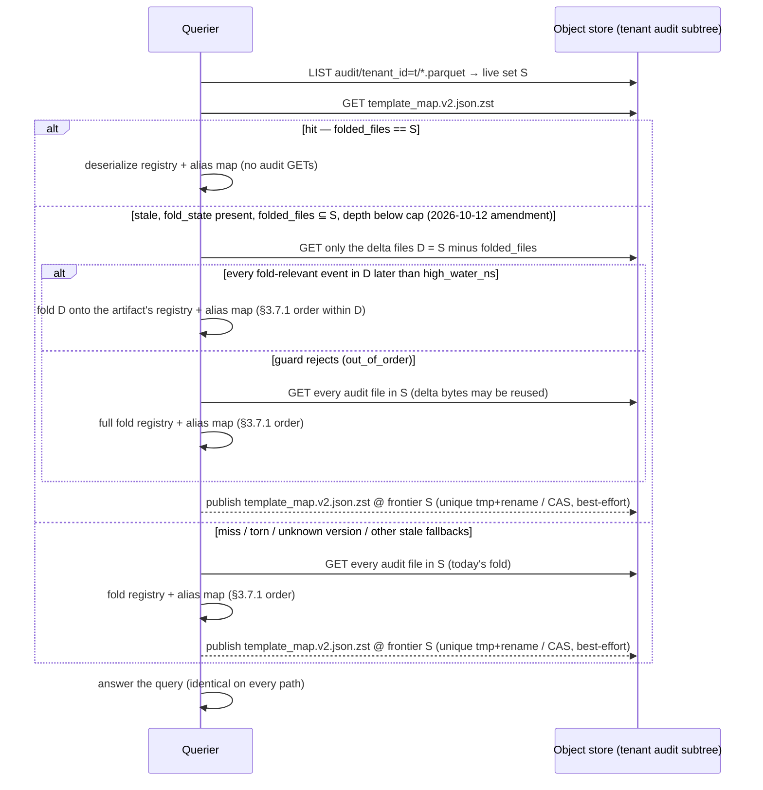

# RFC 0033 — Cached template-map artifact

> **Status: `accepted` (2026-08-25, maintainer sign-off).** Terminal —
> the completed-backlog batch flip. Where a thesis-gate applies it
> stands passing in `docs/benchmarks.md` §7; elsewhere `validated` is
> vacuous for this surface (RFC 0008 precedent).

## 1. Summary

Discharges the RFC 0005 §3.7.1 deferral: a **per-tenant cached
fold of the audit stream** — one artifact carrying both the RFC 0017
§3.2 template registry and the RFC 0005 §3.7.1 alias map — published
to object storage next to the audit files it is derived from. The
audit stream **remains the source of truth**; the artifact is a
derived acceleration, valid only when the exact audit-file set it
folded equals the tenant's live audit-file listing, discardable at
any time, and bypassed (fresh fold, exactly today's behaviour)
whenever absent, stale, torn, or unreadable. Publication follows the
RFC 0009 §3.4 write-tmp-then-atomic-swap precedent; the writer is
the querier itself, write-through after a cache-miss derivation.
This replaces a per-query read of the tenant's entire audit history
— measured at a constant 513,862 bytes per body-rendering query in
RFC 0031 comparative run #8 — with one small object GET.

## 2. Motivation

### 2.1 The deferral condition has been met — and measured

RFC 0005 §3.7.1 pinned v1 as "no persisted per-tenant artifact: the
audit stream *is* the alias store", and deferred the cached map with
an explicit escape hatch — "a pure recovery/latency cache over this
derivation", to be designed when it measurably matters. RFC 0017
§3.6 took the same stance for the template registry: "O(audit
events), the same cost profile as the alias map, acceptable for v1."

It now measurably matters. RFC 0031's honest total-bytes accounting
(§3.6, measurement-fidelity amendment 2026-07-12) counts the
registry derivation into every comparative query's `bytes_read`, and
comparative run #8 (2026-07-12, otel-demo-v8 corpus, 4.9 M records)
measured it at a **constant 513,862 bytes per query**: every query
that renders bodies calls
`template_registry::derive_template_registry_measured`, which walks
`audit_scan::read_all_events` over the tenant's **entire** audit
subtree — every audit Parquet file, full-object GETs on the S3
backend — before answering. The alias map
(`alias_store::derive_alias_map`) folds the same full stream the
same way at query-compile time whenever the DSL uses
`resolves_to`.

Three properties make this a tax worth an RFC rather than a shrug:

1. **It is per-query.** The fold is derived once per executed query
   (RFC 0017 §3.2), so the 514 KB is paid on every body-rendering
   query, not amortised.
2. **It grows with tenant age, not query selectivity.** The audit
   stream is append-only; every widening, type expansion, creation,
   and alias assertion in the tenant's history adds to it. A
   selective query over a day of data pays for the tenant's entire
   template history. This is the inverse of the pruning thesis
   (`CLAUDE.md` §2 pillar #2): the data scan shrinks with
   selectivity while the registry scan only ever grows.
3. **It is now inside the headline metric.** RFC 0031's L-gates
   gate on total bytes read from object storage. A constant
   ~514 KB floor under every Ourios query is a direct, growing
   drag on the project's existential comparison.

### 2.2 Why this layer

The fix belongs at the derivation seam, not in the fold semantics:
`derive_template_registry` / `derive_alias_map` already sit behind
narrow functions whose contract is "the fold of the tenant's audit
history in the §3.7.1 total order". Caching the *result* of that
contract keyed on the *exact inputs* changes no query-visible
semantics — the same "v1 full-replay now, accelerate later, no
format change" shape RFC 0001 §6.9 pinned for the miner snapshot and
RFC 0005 §3.7.1 explicitly promised for this artifact.

## 3. Proposed design

### 3.1 One artifact, not two

The registry and the alias map are folds of the **same** append-only
audit stream, resolved through the same `audit_scan::audit_files`
walk, with the same total fold order and the same validity domain
(the exact set of audit files folded). They ship as **one artifact**:

- One freshness check (one LIST comparison) instead of two.
- One atomic publish, so the two folds can never disagree about
  which frontier they reflect — a split artifact could serve a
  registry at frontier *F1* and an alias map at *F2* in the same
  query.
- The dominant cost being replaced is the shared
  `read_all_events` byte scan, not the per-fold CPU; splitting
  buys nothing there.

The alternative (two artifacts, independently refreshed) is recorded
in §4.

### 3.2 The artifact — format and location

A single JSON object per tenant, named **`template_map.json`**
(**legacy v1 encoding** — key and transport encoding superseded by
the 2026-07-13 amendment at the end of this section; the JSON
*structure* below is unchanged, but v2 carries `format_version: 2`
and ships zstd-compressed at the v2 key), living at the root of the
tenant's audit subtree:

```text
audit/tenant_id=<percent-encoded>/template_map.json
```

- **Object storage per `CLAUDE.md` §3.6** — the artifact lives on
  the same store as the audit files it folds; local disk holds no
  copy the store does not.
- **Tenant-scoped path per `CLAUDE.md` §3.7** — under the same
  `tenant_id=` partition key the audit walk is already scoped to.
- **Invisible to every existing reader by construction**: the local
  audit walk collects only `*.parquet` entries and the S3 listing
  filters `ends_with(".parquet")` (`audit_scan.rs`), so a JSON
  object in the subtree contributes nothing to any deployed
  binary's scan. This is the additive-artifact property §3.6
  relies on.

JSON follows the `manifest.json` precedent (RFC 0009 §3.4): small,
human-inspectable, `serde`-round-tripped, no Parquet machinery for a
kilobyte-scale object. Content:

```json
{
  "format_version": 1,
  "tenant_id": "acme",
  "folded_files": ["year=2026/month=07/day=11/….parquet", "…"],
  "registry": [
    { "template_id": 7, "version": 1, "template": "user <*> logged in" },
    { "template_id": 7, "version": 2, "template": "user <*> logged <*>" }
  ],
  "alias_map": [
    { "representative": 3, "members": [3, 9, 12] }
  ]
}
```

- `folded_files` — the **frontier**: the exact audit `*.parquet`
  file set the folds consumed, as store-relative keys under the
  tenant's audit root, sorted lexicographically. Audit files are
  immutable once committed (uncommitted writers use `*.parquet.tmp`,
  which the walk already ignores), so set equality is a complete
  validity condition — no per-file ETags needed.
- `registry` — the RFC 0017 §3.2 `(template_id, version) → tokens`
  map, template encoded in the canonical space-joined
  `format_template` form the audit stream itself stores (the exact
  input `parse_template` already consumes), so the artifact adds no
  second token encoding to the system.
- `alias_map` — the folded RFC 0001 §6.7 equivalence classes, one
  entry per class, `representative = min(members)` as §6.7 defines.
  Storing the *folded* classes rather than the event log keeps the
  reader a deserialization, not a re-fold.
- `tenant_id` — the row-vs-path discipline (RFC 0005 §3.9,
  `CLAUDE.md` §3.7) applied to the artifact: a reader MUST verify
  it matches the tenant whose path it was fetched from and fail
  loudly on mismatch, exactly as `read_all_events` does for audit
  rows.
- `format_version` — evolution hook: a reader encountering an
  unknown version treats the artifact as **absent** (fresh fold,
  then republish at its own version), mirroring the RFC 0005 §3.9
  unknown-column tolerance. No migration of old artifacts is ever
  required because the artifact is derived and discardable.

**Size bound.** The registry is bounded by RFC 0023's bounded
template memory (per-tenant template count is capped) times the
per-template version count; templates are token strings, not log
data. The alias map is rare operator actions. The artifact is
therefore expected to be kilobytes-to-low-megabytes, and on any
tenant with meaningful history substantially smaller than the audit
stream it folds (which carries the same templates *plus* envelopes,
samples, hashes, and full history) — but this is a measured
expectation, not a guarantee: on a very small tenant the frontier
list and JSON envelope can exceed the audit bytes. The publisher
therefore **abstains** when the serialized artifact is not smaller
than the audit bytes just folded (nothing to win) or exceeds a
configured size ceiling; the exact ceiling is an open question
(§7). Abstention costs nothing — the no-artifact path is today's
behaviour.

> **Amendment (2026-07-13, run #20 / §9.14): compressed artifact
> encoding — `format_version` 2.** Comparative run #20
> (`docs/benchmarks.md` §9.14) showed the v1 encoding losing to its
> own guard on the headline corpus: on otel-demo-v8 the uncompressed
> JSON of every `(template_id, version)` canonical template meets or
> exceeds the 513,862 B *zstd-compressed Parquet* fold it must
> undercut, so the size abstention correctly refused every publish
> and the corpus never ran warm (RFC0033.6's corpus arm
> undischarged, status `green → red`). The defect is transport
> encoding, not structure; this amendment changes only how the bytes
> ship.
>
> - **Encoding.** The artifact body is the §3.2 JSON object,
>   zstd-compressed as a single frame. The JSON structure, field
>   meanings, canonical sort orders, and validation rules above are
>   **unchanged** — only the bytes on the wire are. The compression
>   level is the crate default (3), an implementation constant, not
>   configuration: the object is kilobyte-scale and written once per
>   miss, the template-string JSON is highly redundant (the same
>   strings zstd-compress into the 513,862 B audit Parquet *with*
>   their full event history alongside), so the needed
>   order-of-magnitude win does not hinge on the level; raise the
>   constant in code if run #21 measures the ratio marginal.
> - **Key: `template_map.v2.json.zst`**, same tenant audit root
>   (`audit/tenant_id=<enc>/template_map.v2.json.zst`) — the version
>   moves **into the key**. A pre-amendment reader GETs only
>   `template_map.json`, so for it the v2 artifact is *literal
>   absence* — genuine fresh fold, correct by §3.3's design, with
>   honest telemetry. A post-amendment reader GETs only the v2 key.
>   Both keys stay invisible to every audit walk by construction
>   (local walk keeps only `extension == "parquet"` entries, S3
>   listing filters `ends_with(".parquet")` — `audit_scan.rs`; the
>   filter ignores any number of non-Parquet keys, so a second one
>   changes nothing). Future encoding-affecting bumps repeat the
>   pattern: new key, new in-body version, best-effort delete of the
>   predecessor (§3.4 amendment).
> - **Rejected: same key, magic-frame sniff.** The alternative keeps
>   `template_map.json` and has readers sniff the zstd frame magic
>   (`0xFD2FB528`) before JSON parse. It is *correct* — an old
>   reader GETs the compressed body, fails JSON parse, classifies
>   **Torn**, folds fresh, self-heals — but it lies twice: §3.7
>   pins `torn` as the RFC 0008-style *corruption* signal, so a
>   mixed-version fleet would page on healthy state for as long as
>   one old binary keeps querying; and §3.3's `UnknownVersion`
>   disposition — designed for exactly this evolution — is
>   unreachable there, because the parse fails before the version
>   probe runs. A `.json` key carrying zstd bytes also misnames the
>   object. The one cost of the new-key route — a bounded second
>   key during the mixed-version window, deleted best-effort — is
>   cheaper than a permanently lying corruption signal.
> - **`format_version: 2`, in the decompressed body.** The version
>   names the whole artifact contract *including* the transport
>   encoding, not just the JSON shape: `TEMPLATE_MAP_FORMAT_VERSION`
>   becomes 2, and the probe runs on the decompressed bytes as
>   defense-in-depth — a v1 body planted at the v2 key (or a
>   decompressed v2 body at the v1 key) classifies `UnknownVersion`
>   → treated as absent, harmless, per §3.3's rule.
> - **Dispositions at the v2 key** (§3.3 table unchanged in
>   spirit): not a zstd frame, failed decompression, or
>   post-decompression parse/validation failure → **Torn**;
>   decompressed `format_version` ≠ 2 → **`UnknownVersion`**;
>   `tenant_id` mismatch → loud failure. Everything else as
>   tabulated.
> - **Abstention, restated (unchanged in spirit).** Publish iff the
>   **compressed** artifact byte size is smaller than the audit
>   bytes just folded: the comparison is between the bytes a warm
>   GET would pay and the bytes the fold just paid — the v1 rule
>   applied to the bytes actually shipped.
> - **Telemetry (§3.7).** The artifact-size histogram records the
>   **compressed** (published-object) bytes — the GET cost, which
>   is what the instrument always measured (it records the
>   published bytes, and those are now compressed). Lookup and
>   publish outcome values are unchanged.
> - **Reading rule.** References to `template_map.json` elsewhere
>   in this RFC (§3.3–§3.5, §5, the §3.4 diagram) read as the
>   versioned key post-amendment; the local tmp is
>   `template_map.v2.json.zst.tmp` (extension `tmp`, ignored by the
>   walk as before). *(Superseded 2026-10-12, #962: each local
>   publish uses its own uniquely named temp,
>   `template_map.v2.json.zst.<UUIDv7>.tmp`; see the §3.3 amendment.)*
> - **Dependency.** Zero new dependencies: `zstd` 0.13 is already
>   compiled into every querier build (`parquet` 58's `zstd`
>   feature via `ourios-parquet`, and `arrow-ipc`), and
>   `ourios-bench` already binds the crate directly as the A1
>   reference codec (RFC 0006 §3.4.1). Adding `zstd = "0.13"` to
>   `ourios-querier` introduces no new transitive crate and passes
>   the existing cargo-deny license gate unchanged.
> - **Validation: comparative run #21, before merge.** The
>   amendment is validated by a comparative dispatch from the
>   implementation branch **before** it merges (the
>   measure-before-merge workflow), and the harness MUST print each
>   pair's publish outcome explicitly — `published` (with the
>   compressed size), `abstained` (with the would-be size vs. the
>   folded audit bytes), `lost_race`, or `error` — so run #20's
>   ambiguity (abstention and publish IO failure both leaving the
>   same "no artifact" label) cannot recur.

> **Amendment pointer (2026-10-12, #962,
> maintainer-approved).** The v2 body gains an optional `fold_state`
> object (`high_water_ns`, `binding_conflicts`, `incremental_depth`)
> that the incremental fold needs. `format_version` stays 2, the key
> is unchanged, and an artifact without the field is ineligible for
> the incremental path. The specification is the §3.3 amendment of
> the same date.

### 3.3 Freshness — the frontier check

The audit stream is append-only, so cache validity is exactly:

> the artifact's `folded_files` set **equals** the tenant's live
> audit-file listing at read time.

The read path becomes:

1. List the tenant's audit `*.parquet` set (the existing
   `audit_files` walk / prefix LIST — no GETs).
2. GET `template_map.json`. If absent, torn (JSON parse failure),
   unknown `format_version`, or `tenant_id`-mismatched — see
   dispositions below.
3. If `folded_files` == the live set (set equality; both sides are
   sorted-unique already): **cache hit** — deserialize, use.
4. Otherwise (new files appended, or files removed by a future
   retention/GC): **stale** — fall back to the fresh fold over the
   live set, exactly today's `read_all_events` path, then
   write-through (§3.5).

Dispositions, pinned:

| Condition | Disposition |
|---|---|
| Artifact absent | Fresh fold (today's behaviour), write-through |
| Frontier ≠ live set | Fresh fold, write-through at the new frontier |
| Torn / unparseable JSON | Treat as absent; fresh fold, write-through overwrites; emit telemetry (§3.7) |
| Unknown `format_version` | Treat as absent (forward compat) |
| `tenant_id` mismatch | **Fail the query loudly** — corrupt or foreign object under the tenant's root, same stance as the audit row-vs-path backstop |

The first four never produce a wrong answer — every non-hit path is
the v1 fold. The stale-cache fallback is *re-derive, never serve
stale*: a hit reflects exactly the events a fresh fold at the same
listing would, so the RFC 0005 §3.7.1 consistency bound
(audit-flush visibility) is unchanged by this RFC. The only ordering
requirement is LIST-before-GET-is-compared: the frontier comparison
uses one listing, taken once, for both the validity check and the
fallback fold, so a file appearing mid-query affects a cached and an
uncached query identically.

> **Amendment (2026-07-13, run #20 / §9.14).** At the v2 key (§3.2
> amendment), "torn / unparseable JSON" includes a missing zstd
> frame or a failed decompression, and the unknown-`format_version`
> probe runs on the *decompressed* bytes. The table's dispositions
> and the LIST-before-GET rule are otherwise unchanged. Note the
> version-in-key choice means a pre-amendment reader never fetches
> a v2 artifact at all: for old binaries the encoding bump manifests
> as literal absence — the cleanest possible realization of the
> unknown-version-is-absent rule this table was designed around.

> **Amendment (2026-10-12, #962, maintainer-approved): guarded incremental fold on staleness.** Production
> evidence (the production node, v0.12.2, 24 h): every template-map derive
> had `ourios.template_map.derive.reason = stale`, derive p95 was
> 58–111 s, acquire-wait reached 46 s, and one cold derive read
> ~7,375 audit files (~1 GB) for one tenant. A stale artifact is
> almost always "the same history plus a few appended files", yet row
> 4 of the table above re-reads the whole history. This amendment
> adds a guarded fast path to that row and closes the §7 open
> question. Every other row, the LIST-before-GET rule and
> "re-derive, never serve stale" are unchanged: the incremental path
> produces the map a full fold over the same listing would, or it is
> not taken.
>
> **The artifact carries its fold state** (§3.2 pointer amendment).
> An optional `fold_state` object joins the v2 body:
>
> ```json
> "fold_state": {
>   "high_water_ns": 1760227200123456789,
>   "binding_conflicts": [ { "template_id": 7, "version": 2 } ],
>   "incremental_depth": 3
> }
> ```
>
> - A **fold-relevant event** is one either fold consumes: a template
>   event that binds a `(template_id, version)` key (`created`,
>   `widened`, `type_expanded`, `adopted`; a degenerate-widening
>   rejection binds none) or an `alias_asserted` / `alias_retracted`
>   event. Compaction, quarantine, ingest-denied, erasure and unknown
>   events change neither fold, so they never constrain the guard.
> - `high_water_ns` — the greatest RFC 0005 §3.7 `timestamp`
>   (`TIMESTAMP(NANOS, UTC)`, as integer nanoseconds since the epoch)
>   of any fold-relevant event in `folded_files`; `null` when there is
>   none. It is a JSON integer, read and written as `u64`, never
>   through a float.
> - `binding_conflicts` — the RFC0033.8 conflict set of the fold
>   (every key seen bound to two semantically different templates),
>   sorted ascending by `(template_id, version)`. The registry keeps
>   only each key's winner, so without this field an incremental fold
>   cannot know a key was already in conflict (see *Equivalence*).
> - `incremental_depth` — the number of incremental folds since the
>   last full fold; a full fold writes `0`.
>
> Validation, in addition to §3.2's (a failure classifies **Torn**):
> `binding_conflicts` strictly sorted and each key present in
> `registry`; `high_water_ns = null` only when `registry` and
> `alias_map` are both empty; `incremental_depth` ≤ the depth cap.
>
> **Evolution: an optional field, not a version bump.**
> `format_version` stays 2 and the key stays
> `template_map.v2.json.zst`. The field is additive: the pre-amendment
> reader's serde struct does not deny unknown fields, so an old
> binary serves a `fold_state` artifact on a hit exactly as before,
> and on a stale lookup it full-folds and republishes without the
> field. A new binary treats an artifact without `fold_state` as
> ineligible for the incremental path (full fold, then republish with
> the field). A mixed fleet therefore stays correct; it only loses
> the fast path until the old binaries retire. A bump (v3 at a new
> key) was rejected: it buys nothing for correctness (the absent
> field already means "full fold"), and the §3.2 amendment reserves
> new keys for encoding changes. The persisted-layout-break license
> pre-production is not needed here. No reader ever needs a dual read.
>
> **The guard.** Given the one listing (live frontier `L`) and a
> `Valid` artifact `A` whose `folded_files` `F` ≠ `L`, the querier
> takes the first matching row:
>
> | Condition | Disposition | `derive.fallback.reason` |
> |---|---|---|
> | `A` has no `fold_state` | Full fold | `no_fold_state` |
> | `F ⊄ L` (a folded file disappeared) | Full fold | `files_removed` |
> | `incremental_depth` ≥ the depth cap | Full fold (writes depth 0) | `depth_cap` |
> | `high_water_ns` is non-null and delta `D = L \ F` holds a fold-relevant event with `timestamp ≤ high_water_ns` | Full fold | `out_of_order` |
> | Otherwise | **Incremental fold** of `D` onto `A` | — |
>
> - **A `null` high-water admits any delta.** `null` means `F` holds
>   no fold-relevant event, so no delta event can be ordered before
>   one, and the timestamp guard passes whatever `D` holds. The
>   equivalence below still holds: validation pins `registry` and
>   `alias_map` empty when the high-water is `null`, and every
>   `binding_conflicts` key must be in `registry`, so that set is
>   empty too. The seeded fold therefore starts from the empty state,
>   which is exactly the full fold's state after `F`'s events, and
>   the fold-relevant events in the total order over `L` are exactly
>   `D`'s, in `D`'s own order. No key is seeded, so the seed timestamp
>   is never used.
> - **"New" is set difference, nothing else.** `D` is the listed
>   `*.parquet` keys not in `F`, in the lexicographic order the full
>   fold scans. Audit keys are immutable once visible (uniquely named
>   `<UUIDv7>.parquet`; a single PUT on S3, tmp+rename locally; §3.2),
>   so a key in both `F` and `L` names the same bytes.
> - **What is deliberately not trusted.** The guard reads the
>   fold-order key itself, the event `timestamp`, from the delta's
>   rows. It never infers order from anything else. The UUIDv7 in the
>   key is the writer's clock at file open, which skews between
>   ingester, compactor and querier processes. The `day=` partition
>   is derived from the event timestamp, so a backdated event lands
>   in an old day directory. LIST order is lexicographic, not
>   temporal. An object's `LastModified` is store PUT time and has no
>   local-backend equivalent. A rule built on any of these would
>   admit a delta that a full fold orders differently.
> - **The guard is strict (`>`, not `≥`).** A delta event at exactly
>   `high_water_ns` would tie an already-folded event, and the full
>   fold breaks that tie by file path, which an append cannot see.
>   Ties fall back.
> - **Reading the delta is the guard's price.** The delta must be
>   fetched to learn its minimum timestamp. On a rejection the full
>   fold runs over `L`; an implementation may reuse the delta bytes
>   it already holds, and the telemetry counts the objects actually
>   fetched.
>
> **The incremental fold.** The registry fold is seeded with `A`'s
> registry, every held key at timestamp `high_water_ns`; the alias
> projection with `A`'s classes; the conflict set with
> `binding_conflicts`. `D`'s events are read in scan order, with the
> same row-level tenant backstop, and each fold then orders them by
> the full key `(timestamp, file path, row index)` the way it already
> does for a full fold. `RegistryFold` does this while streaming: it
> replaces on `>=` timestamp in scan order. `AliasFold` buffers the
> alias events and stably sorts them by timestamp before applying
> them. The incremental path differs only in what the projection
> starts from: `A`'s classes instead of the empty map. The guard
> orders `F` before `D`, and it is these folds that order events
> *within* `D`. Applying delta alias events in raw scan order would
> be wrong: interleaved timestamps across delta files would reorder
> union and retraction. The result carries `folded_files = L`,
> `high_water_ns = max(high_water_ns, the delta's greatest
> fold-relevant timestamp)`, the union conflict set, and
> `incremental_depth + 1`. A delta with no fold-relevant event (only
> compaction events, say) passes trivially. It leaves the registry,
> alias map, conflict set and `high_water_ns` unchanged, but it is
> still an incremental step: `folded_files` grows and
> `incremental_depth` increments, counting toward the cap.
>
> **Equivalence.** The full fold's order is RFC 0005 §3.7.1's
> `(timestamp, file path, row index)`. When the guard passes, every
> fold-relevant delta event is strictly later than every
> fold-relevant event in `F`, so in that order all of `F`'s relevant
> events precede all of `D`'s. Non-relevant events change neither
> fold, so they may sit anywhere. Within `D`, scan order is the
> restriction of the full scan order. Therefore:
>
> - **Registry.** A key's full-fold winner is its last binding in the
>   total order: `D`'s last binding of the key if `D` binds it,
>   otherwise `F`'s winner, which is what `A` holds (RFC0033.1). The
>   seeded fold computes exactly that: every delta binding has a
>   timestamp greater than the seed's, so it replaces the seed, and
>   among delta events the existing `>=`-in-scan-order rule picks the
>   total-order last.
> - **Alias map.** `AliasMap::apply` is a state machine whose whole
>   state is the class set. `A`'s classes are the state after `F`'s
>   events (RFC0033.1). The alias fold's stable timestamp sort over
>   `D`'s scan-ordered events produces exactly `D`'s restriction of
>   the total order, and applies it after them.
> - **Binding conflicts.** A key is in conflict iff its bindings span
>   at least two distinct token sequences, regardless of order. If
>   `F` already held two, the key is in `binding_conflicts`. If `F`
>   held one (so `A`'s winner has it), a distinct delta binding
>   differs from the held text or from an earlier delta binding, and
>   the fold's existing check flags it. Without the persisted set the
>   first case is lost, which is why the field exists.
> - **Frontier and high-water** are the union and the max by
>   construction.
>
> Each incremental step is thus a full fold over its listing, and by
> induction so is any chain of steps. RFC0033.10 property-tests both.
>
> **Late, out-of-order and concurrent writers.** Every case reduces
> to the guard:
>
> - *An ingester flushes a buffered or retried batch late*, or *a
>   second ingester or the compactor writes concurrently*: the new
>   file is in `D`. If its fold-relevant events are later than the
>   high-water it folds incrementally; if not, `out_of_order`.
> - *Clock skew between writers*: a writer whose clock runs ahead
>   raises `high_water_ns`, and an honest writer's next relevant
>   events then fail the guard until real time passes the skewed
>   mark. Correct, but it degrades to full folds, and the
>   `out_of_order` fallback rate is the signal.
> - *A file was invisible to the listing that built `A`* and appears
>   later with backdated events: it is in the next `D` and fails the
>   guard. Listing consistency is otherwise unchanged from §3.3. The
>   incremental and full paths consume the same one listing, so a
>   missing file affects both identically.
> - *Concurrent queriers*: as §3.4, per backend.
>   - **S3:** the incremental publish is a CAS against the `ETag` of
>     the artifact it extended. A lost race is harmless, because every
>     artifact is a correct fold of its own frontier.
>   - **Local:** publication is a rename with no precondition, so the
>     last writer wins and no `lost_race` occurs. This is safe, and is
>     required to stay safe, for one reason: every artifact either
>     writer can install is a correct fold of the listing it was built
>     from, with a `fold_state` describing exactly that listing. A
>     rename of an older fold (frontier `F1`) over a newer one (`F2`)
>     therefore makes the artifact staler, never wrong. The next read
>     sees `F1 ≠ L` and runs the guard against `F1`'s own
>     `high_water_ns` and `binding_conflicts`, which are correct for
>     `F1`. The overwritten artifact's state is not needed, because
>     the delta from `F1` re-covers it.
>   - **`incremental_depth` after an overwrite:** the count belongs to
>     the surviving artifact's own lineage, i.e. the number of
>     incremental steps since the full fold it descends from. It stays
>     an exact count and the cap still bounds the surviving lineage.
>     The overwritten lineage simply ends.
>   - **The one local requirement:** each publish writes its own
>     **uniquely named** temp file in the tenant's audit directory
>     (e.g. `template_map.v2.json.zst.<UUIDv7>.tmp`, extension `tmp`,
>     ignored by the walk) and renames it into place. Today's fixed
>     `template_map.v2.json.zst.tmp` lets two concurrent publishers
>     write into the same temp file. One rename could then install
>     interleaved bytes. That would almost surely classify Torn and
>     self-heal, but it is not a correct fold of any listing. A unique
>     temp name restores the property the argument above relies on:
>     every renamed file is one writer's complete artifact. A stray
>     temp left by a crash is harmless, as before.
> - *Deletion, retention, audit compaction or rewrite*: no code
>   deletes or rewrites audit files today. Any future one removes a
>   key from `F`, so the next acquisition is `files_removed`, a full
>   fold. A rewrite under the *same* key would break §3.2's
>   immutability premise for the plain hit path too. It is
>   out of contract for both.
>
> **Bound: a depth cap, no timer.** The equivalence holds for chains
> of any length, so the cap is not needed for correctness. It bounds
> the blast radius of an undetected implementation defect. A
> persisted artifact is otherwise only rebuilt from the source of
> truth when something else forces a full fold, and on a busy tenant
> that may be never. The cap is a code constant, 256, not
> configuration: it costs one full fold per 256 stale acquisitions.
> A wall-clock refresh was rejected because it adds a clock to a
> rule that is otherwise a pure function of the store.
>
> **Write-through and abstention** (§3.5 pointer amendment). An
> incremental fold publishes like a full one. Abstention keeps its
> principle: publish iff the compressed artifact costs less than what
> the next acquisition would pay without this publish. After a full
> fold that is the folded audit bytes, as before. After an
> incremental fold it is the base artifact's bytes plus the delta's.
> `QueryResult::registry_bytes_read` stays "template-map acquisition
> bytes": the artifact GET plus every audit object fetched.
>
> **Telemetry** (§3.7 pointer amendment). The lookup outcome stays
> `stale` and `ourios.template_map.derive.reason` stays `stale`.
> RFC0033.9 pins that the reason is known *before* the fold, and the
> path is only known after the guard has read the delta. Two
> attributes are added to `ourios.template_map.derive.duration`,
> `derive.audit.files` and `derive.audit.size`:
>
> - `ourios.template_map.derive.mode`: `full` / `incremental`,
>   **conditionally required**: present once the path is decided. A
>   miss, torn or unknown-version derive is always `full`. A `stale`
>   derive carries it once the guard has decided, and a failure after
>   that point keeps the decided mode. A `stale` derive that fails
>   before the guard decides (e.g. a delta object fails to read or
>   decode while its timestamps are being checked) records its
>   duration sample **without** `mode`, carrying `error.type` as
>   RFC0033.9 requires. No third value is added for "undecided";
>   the attribute's absence means exactly that;
> - `ourios.template_map.derive.fallback.reason`: the guard row that
>   declined the fast path (`no_fold_state` / `files_removed` /
>   `depth_cap` / `out_of_order`), only on `stale` samples with
>   `mode = full`.
>
> Both names are new. They are maintainer-approved and registered in
> the shared `ourios-semconv` registry via ourios-semconv#17; the
> registry pin bump lands with the implementation. The OTel naming
> guidance (`{object}.{property}`, closed enums for short value sets)
> was checked, and no upstream attribute fits. Duration covers the
> whole acquisition, including a rejected delta read. The files/size
> samples count the objects actually fetched. An incremental
> acquisition reports conflicts like any fold-backed one (RFC0033.8),
> i.e. the whole union set, as the full fold would.
>
> **What this does not change.** The freshness LIST still walks the
> whole audit prefix (~7,375 keys, about 8 LIST pages per
> acquisition on the node above). Bounding it is #853 option (a), a
> separate amendment. Whether a **hit** re-reports `binding_conflicts`
> stays #928. This amendment persists the set, which #928's option 1
> needs anyway, but leaves the hit-path report cadence to that issue.
>
> **Expected effect** (measured on Dash0, scenario RFC0033.14). A
> stale acquisition's audit IO goes from O(tenant history) to O(files
> since the last publish), plus one artifact GET. Against the
> baseline above:
>
> - stale derive p95 drops from 58–111 s to seconds;
> - acquire-wait tracks it;
> - audit GETs per stale derive drop from ~7,375 to the delta count;
> - the 5–100 s tail (~10% of queries) shrinks to the residual
>   full-fold fallbacks.
>
> The ~187k object-store calls per 6 h should fall by roughly the
> audit GETs that full re-folds paid. LIST pages remain until #853.
> The status stays `accepted`. Scenarios RFC0033.10–RFC0033.14 are
> the criteria.

### 3.4 Atomic publish — the RFC 0009 §3.4 precedent

The artifact is published the way the compaction manifest is
committed:

- **Local backend**: write `template_map.json.tmp`, `rename` into
  place (`Manifest::write_atomic` shape). A crash mid-write leaves
  the prior artifact (or its absence) authoritative and a harmless
  `.tmp` for the GC sweep; the rename is the only visibility point.
- **S3 backend**: single-object conditional put
  (`Manifest::publish_cas` shape). Object stores make the whole PUT
  visible atomically; the conditional (create / ETag-match)
  precondition prevents interleaved writers from tearing each
  other.

Unlike the manifest, a **lost race is harmless here**: every writer
publishes a correct fold of *some* frontier, the reader verifies the
frontier independently at every read (§3.3), and a superseded
artifact is simply detected stale on the next query and rewritten.
So on CAS conflict the loser discards its write and moves on — no
retry loop, no error. The manifest needed CAS to prevent *lost
updates* of authoritative state; the cache needs only *atomicity of
the object itself*, and gets CAS cheaply because the primitive
already exists.

> **Amendment (2026-07-13, run #20 / §9.14).** The publish targets
> the v2 key (`template_map.v2.json.zst`; local tmp
> `template_map.v2.json.zst.tmp`, same rename — *superseded
> 2026-10-12, #962: a uniquely named
> `template_map.v2.json.zst.<UUIDv7>.tmp` per publish, see the §3.3
> amendment*; same CAS ladder on
> S3, the expectation being the v2 key's observed ETag or
> create-if-absent), and on a successful publish best-effort
> **deletes** the stale v1 `template_map.json` key. The delete is
> unconditional (no CAS needed — any v1 artifact is derived and
> discardable by definition) and never a query failure; a crash or
> failure between publish and delete leaves both keys, which is
> harmless: each reader population GETs only its own key and
> verifies the frontier at every read, and the next successful v2
> publish retries the delete implicitly. During a mixed-version
> window an old binary's write-through may republish the v1 key (on
> tenants where the uncompressed artifact still beats the fold);
> correctness is unaffected — each version population maintains its
> own cache — and hygiene converges once old binaries retire.



*Diagram updated 2026-10-12 (#962) for the §3.3 incremental-fold
amendment. "Other stale fallbacks" are `no_fold_state`,
`files_removed` and `depth_cap`. Abstention (§3.5) can skip any
publish arrow.*

### 3.5 Who writes it — querier write-through

**Position: the querier publishes, write-through, after every
cache-miss derivation.** After a fresh fold (miss or stale), the
querier serializes the fold it already holds plus the frontier it
already listed, and publishes best-effort — a publish failure is
telemetry, never a query failure.

**Both folds, one scan — never a partial artifact.** The two
derivation call sites are asymmetric (body rendering derives only
the registry; only `resolves_to` queries derive the alias map), so
a naive write-through after a registry-only miss would publish an
artifact with an empty alias fold that a later alias query would
trust. The miss path therefore folds **both** maps from the single
`read_all_events` capture it already paid for — the marginal cost
is CPU over in-memory events, zero extra IO — and publication of a
partially populated artifact is forbidden by construction.
RFC0033.1's property test covers both folds, and RFC0033.6's
integration arm includes a body-rendering query followed by a
`resolves_to` query against the artifact the first one published.

Rationale:

- **Zero extra derivation work.** The fold and the frontier are in
  hand at exactly the moment of publish; no component re-derives
  anything to warm the cache.
- **No ingest-path coupling.** The WAL-before-ack hot path
  (`CLAUDE.md` §3.4) gains no IO, no new failure mode, and no
  knowledge of reader-side fold semantics.
- **Warms exactly where it pays.** Tenants that query get a warm
  cache after the first miss; tenants that never query never pay a
  publish.
- **Self-healing.** Any wrong, torn, or ancient artifact costs one
  fresh fold and is overwritten on the same query.

The consequence to own honestly: on an actively-mutating tenant
(templates still being widened), every mutation staleness-misses the
next query, which pays one fresh fold plus one publish. That is
today's cost plus a small PUT — never worse than v1 by more than the
publish — and template mutation decays as a tenant's template set
converges (the miner's convergence thesis, RFC 0001). The
ingester-side write-through at mutation time is the recorded
alternative (§4, §7).

> **Amendment pointer (2026-10-12, #962,
> maintainer-approved).** The cost described in the paragraph above,
> one fresh fold per mutation-driven staleness, becomes one fold of
> the *new* audit files on top of the loaded artifact whenever the
> §3.3 guard admits it. An incremental fold writes through like a
> full one. Its abstention comparison is against the base artifact
> plus delta bytes, i.e. what the next acquisition would pay without
> the publish. See the §3.3 amendment of the same date.

### 3.6 Back-compat — additive and advisory (`CLAUDE.md` §3.5)

This RFC changes **no Parquet schema**: no columns added, removed,
renamed, or retyped. The artifact is a new single JSON object whose
name no existing code path matches (§3.2). Concretely:

- **Old binaries, new stores**: deployed readers filter
  `*.parquet`; they never see the artifact and behave byte-for-byte
  as today.
- **New binaries, old stores**: artifact absent → fresh fold,
  today's behaviour, then write-through.
- **Deletion at any time**: an operator (or a GC policy) may delete
  `template_map.json` unconditionally; the sole cost is one
  re-derivation. Nothing durable depends on it.
- **The audit stream remains the single source of truth** for
  template and alias history — this RFC makes that normative for
  the cache: no code path may treat the artifact as authoritative
  over the stream, and any doubt (parse failure, unknown version,
  frontier mismatch) resolves by folding the stream.

### 3.7 Observability (`CLAUDE.md` §6.3)

Via OTel meters on the existing querier metrics path, names to be
minted through the semconv registry (`weaver`):

- cache lookups, keyed by outcome
  (`hit` / `miss` / `stale` / `torn` / `unknown_version`) — the
  torn/unknown outcomes are the RFC 0008-style corruption signal
  for a derived artifact;
- publishes, keyed by outcome (`published` / `lost_race` /
  `error`);
- the artifact byte size at publish (the number RFC0033.6 gates
  on).

`QueryResult::registry_bytes_read` is today documented as bytes
fetched from the tenant's **audit stream**; a cache hit fetches the
artifact instead, and the artifact carries the alias fold and
frontier alongside the registry. At green this RFC therefore
**amends the field's contract** (and RFC 0031 §3.6's wording) to
*template-map acquisition bytes*: the total bytes fetched to obtain
body-rendering capability, whatever the source — the audit-stream
fold on a miss, the artifact GET on a hit. One field, one honest
meaning, no separate channel; the comparative harness needs no code
change, and the alternative (a separate artifact-bytes field with
the old field pinned to audit-stream-only) is recorded in §4.

> **Amendment (2026-10-10, #927, maintainer-approved): binding
> conflicts.** Within one `(template_id, version)` the template never
> legitimately changes, because widening and type expansion bump the
> version. The registry fold therefore checks every key it already
> holds against each incoming binding. A semantically different
> template (different parsed tokens) is a binding conflict, i.e. a
> template-id collision (CLAUDE.md §3.1). Each fold-backed acquisition
> reports every conflicting key once:
>
> - the `ourios.template_map.binding.conflicted` log event (WARN),
>   carrying `ourios.tenant`, `ourios.template.id` and
>   `ourios.template.version`. The template texts are never attached,
>   because they can contain user data;
> - `ourios.template_map.lookup.anomaly = binding_conflict` on that
>   acquisition's lookup data point.
>
> The served map is unchanged and stays last-wins. An identical
> re-emit is not a conflict. Neither is a widening (a new version) or
> an adoption riding an existing leaf, which restates the leaf's text
> exactly. A cache hit runs no fold, so it doesn't re-report a
> conflict; persisting conflicts in the artifact is #928. The status
> stays `accepted`. Scenario RFC0033.8 is the criterion.

> **Amendment (2026-10-11, #924, maintainer-approved): what an
> acquisition costs.** The lookup counter says a derive happened, not
> what it cost. Each fold behind a non-hit lookup also records:
>
> - `ourios.template_map.derive.duration` (s), keyed by
>   `ourios.template_map.derive.reason` (`miss` / `stale` / `torn` /
>   `unknown_version`). The reason is known before the fold, so a
>   failed fold records its duration too, with `error.type`;
> - `ourios.template_map.derive.audit.files` ({file}) and
>   `ourios.template_map.derive.audit.size` (By), the audit set a
>   completed fold read, by the same reason.
>
> A hit records none of them. A failure before the disposition is
> known (the audit listing, or a fetched artifact naming another
> tenant) runs no fold and records no derive sample. A query that
> joins another query's in-flight acquisition records
> `ourios.template_map.acquire.wait.duration` (s, no attributes): the
> time it waited, whether the shared acquisition succeeded or failed.
> Its `joined` lookup outcome stays success-only. The acquirer records
> no wait. The status stays `accepted`. Scenario RFC0033.9 is the
> criterion.

> **Amendment pointer (2026-10-12, #962,
> maintainer-approved).** The derive instruments gain
> `ourios.template_map.derive.mode` (`full` / `incremental`) and
> `ourios.template_map.derive.fallback.reason` (`no_fold_state` /
> `files_removed` / `depth_cap` / `out_of_order`). The lookup outcome
> and `derive.reason` are unchanged. Both names are new, approved and
> registered via ourios-semconv#17 (the pin bump comes with the
> implementation). The specification is the
> §3.3 amendment of the same date; scenario RFC0033.13 is the
> criterion.

## 4. Alternatives considered

**Two artifacts (registry and alias map separately).** Independent
refresh would let an alias assertion invalidate only the alias
artifact. Rejected: both folds share one byte-dominant input scan
and one validity domain; splitting doubles the freshness checks and
publish points, and admits frontier divergence between the two folds
inside a single query (§3.1). Alias events are also so rare that
independent refresh buys nothing measurable.

**Ingester write-through at template-mutation time.** The component
that *emits* the audit event updates the artifact in the same
breath, so queries never miss. Rejected for v1: it puts derived-
artifact IO and reader-side fold semantics on the ingest path
(against §3.4's discipline of keeping the hot path minimal), it
publishes on every widening for tenants nobody queries, and under
ingester/querier role separation the ingester would need the
querier's fold code. Recorded as the natural v2 if miss-rate
telemetry (§3.7) shows mutation-driven staleness dominating. §7.

**A background refresher (compactor-style loop).** A periodic task
re-folds and republishes per tenant. Rejected: it adds a scheduling
component and a staleness *window* policy for something the
write-through gets for free at the moment of demand, with the
freshness check making the window irrelevant to correctness anyway.

**Parquet instead of JSON for the artifact.** Consistency with the
data plane and columnar compression. Rejected: the object is
kilobyte-scale, read whole or not at all, never predicate-pushed;
`manifest.json` set the precedent that flat derived metadata is
JSON. Parquet here is machinery without a query.

**Incremental fold on staleness (fold only the new files onto the
cached state).** Attractive — staleness usually means a few appended
files. Rejected *as the pinned behaviour* because it is not
generally equivalent to a fresh fold: the §3.7.1 total order sorts
by event timestamp *across* files, and an appended file may carry an
event timestamped before already-folded events (clock skew, late
flush), which an append-only incremental fold would order
incorrectly. A guarded fast path (apply only when the new files'
minimum timestamp ≥ the folded maximum, recorded in the artifact)
stays open in §7; the unconditional fallback is the fresh fold.
*(2026-10-12, #962, maintainer-approved: that guarded fast path is specified
in the §3.3 amendment, with a strict `>` guard so that ties fall
back. The unguarded append-only fold stays
rejected, for the reason given here.)*

**Guarding on key order, partition or object timestamps instead of
event timestamps** (2026-10-12, #897). Skipping the delta read by
trusting the UUIDv7 in the key, the `day=` directory, or
`LastModified` would save GETs on a rejection. Rejected: none of
them is the fold's ordering key. Writer clocks skew, backdated events
land in old day directories, and a store's PUT time says nothing
about event time. A guard on any of them could admit a delta the
full fold orders differently.

**Do nothing (keep the v1 fold).** The RFC 0005 §3.7.1 deferral was
explicitly conditioned on measurement; run #8 produced the number
(§2.1). A constant per-query floor that grows with tenant age and
sits inside the RFC 0031 headline metric fails the condition.

## 5. Acceptance criteria

> **Scenario RFC0033.1 — Cached fold ≡ fresh fold (property)**
> - **Given** any generated per-tenant audit-event history (template
>   creations/widenings/type-expansions/rejections and alias
>   assertions/retractions, arbitrary timestamps including
>   same-nanosecond ties), flushed to one or more audit Parquet
>   files
> - **When** the fold is derived fresh and published, and a second
>   read resolves it through the artifact (frontier equal, cache
>   hit)
> - **Then** the cache-hit registry equals the fresh
>   `derive_template_registry` result and the cache-hit alias map
>   equals the fresh `derive_alias_map` result, for every key
> - **And** the query answer produced through either path is
>   identical.

> **Scenario RFC0033.2 — Staleness is detected and never served**
> - **Given** a published artifact at frontier *S*
> - **When** new audit events are flushed (one or more new audit
>   files appear) and a query runs
> - **Then** the frontier check fails, the artifact is bypassed, and
>   the answer equals the no-cache fold over the live set —
>   including events in the new files
> - **And** the querier republishes at the new frontier, and a
>   subsequent unchanged-store query is a cache hit
> - **And** the same holds when files *disappear* from the live set
>   (frontier is set equality, not subset).

> **Scenario RFC0033.3 — Crash/tear safety around the publish**
> - **Given** a publish interrupted mid-write (simulated: a stray
>   `template_map.json.tmp`, a truncated/corrupt
>   `template_map.json`, or an S3 CAS loss to a concurrent writer)
> - **When** the next query runs
> - **Then** a stray `.tmp` is ignored, a torn artifact is treated
>   as absent (fresh fold — the query succeeds with the correct
>   answer, no error surfaced), a CAS loss discards the losing
>   write without failing its query
> - **And** the torn-artifact case emits the §3.7 `torn` outcome
> - **And** the fresh fold's write-through overwrites the torn
>   artifact, so the store self-heals.

> **Scenario RFC0033.4 — Additive and advisory (back-compat)**
> - **Given** a store with no artifact (old data) and a binary with
>   cache support
> - **When** a body-rendering query runs
> - **Then** the result is identical to the pre-RFC binary's result
>   and the fold reads the audit stream exactly as today
> - **And** deleting the artifact between two queries changes
>   neither query's answer
> - **And** the artifact's presence changes nothing a `*.parquet`
>   scan sees: the audit file walk/listing over a store carrying the
>   artifact returns the same file set as without it.

> **Scenario RFC0033.5 — Tenant isolation**
> - **Given** two tenants with distinct template/alias histories and
>   published artifacts
> - **When** each tenant queries
> - **Then** each cache hit serves only that tenant's registry and
>   alias map (paths tenant-scoped under `tenant_id=<enc>`)
> - **And** an artifact whose body `tenant_id` differs from the
>   tenant of the path it was fetched from fails the query loudly
>   (the row-vs-path stance), never silently serving or ignoring
>   foreign data.

> **Scenario RFC0033.6 — The measured tax collapses (RFC 0031
> channel)**
> - **Given** the RFC 0031 headline-corpus shape (otel-demo-v8,
>   4.9 M records — run #8 baseline: `registry_bytes_read` =
>   513,862 B constant per query) ingested, and a warm published
>   artifact
> - **When** a body-rendering query runs cache-warm
> - **Then** `QueryResult::registry_bytes_read` equals the artifact
>   object's byte size exactly (the only registry-path GET is the
>   artifact)
> - **And** the ratio `warm.registry_bytes_read /
>   cold.registry_bytes_read ≤ 1/2` on that corpus — the gate is
>   the ratio, not an absolute byte count, so it holds as the
>   corpus and baseline evolve
> - **And** both numbers are recorded in `docs/benchmarks.md`
>   alongside the run #8 baseline.

**Amendment (2026-07-14, run #21 / §9.15): the corpus ratio gate is
`≤ 1/2`, superseding the original `≤ 1/10`.** The 1/10 was calibrated
when the artifact was assumed kilobyte-scale; run #21 measured the
v2 (zstd) artifact at 187,904 B against the 513,862 B fold —
warm/cold ≈ 1/2.73 — and revealed the actual structure: the artifact
is **O(live template state)** while the fold is **O(audit history)**.
The fold grows append-only forever (every widening event carries both
old and new template text); the artifact is bounded by the tenant's
template cardinality. On a young corpus like otel-demo-v8 history has
not yet outgrown state, so a fixed 1/10 measures the corpus's age,
not the design. The `≤ 1/2` floor asserts a real margin (comfortably
past the §3.2 abstention bound of `< 1`), and the ratio only improves
as a tenant ages. The uncredited wins stay recorded alongside: one
GET replaces the whole audit-tree walk (request count, latency), and
the honest per-query total drops by the fold-minus-artifact delta.
zstd-level tuning beyond the default is a §7 open question, not a
requirement.

**Run #20 note (2026-07-13, §9.14):** undischarged on the corpus.
The dispatch shows every pair cold with **no artifact published** —
consistent with §3.2's size abstention: the artifact is uncompressed
JSON of every `(template_id, version)` canonical template, while the
513,862 B it must beat is the zstd-compressed Parquet of the same
strings, so on otel-demo-v8 the guard correctly refuses a publish
that would make warm acquisition cost *more* bytes than the fold.
The local-shape arm (`rfc0033_6_measured_tax_collapses`, 55.8×)
stands; this corpus arm needs a compressed artifact encoding
(`format_version` 2 — cheap by §3.3's own rule: unknown versions are
treated as absent, no migration) before the gate can be measured.
The scenario stays as written; the RFC status returns to `red` until
it passes.

**Amendment pointer (2026-07-13):** the compressed encoding this
note calls for is specified in the §3.2 amendment. The scenario text
above needs **no change**: the "artifact object's byte size" a warm
GET pays *is* the compressed object's size, and the ratio gate is
encoding-agnostic. Validation is comparative run #21, dispatched
from the implementation branch before merge (measure-before-merge),
with the harness printing each pair's publish outcome — `published`
(compressed size) / `abstained` (would-be size vs. folded audit
bytes) / `lost_race` / `error` — so run #20's abstention-vs-failure
ambiguity cannot recur.

> **Scenario RFC0033.7 — Observable outcomes**
> - **Given** a served querier with the OTel metrics pipeline
>   (RFC 0016) active
> - **When** queries drive a miss, a hit, a staleness, and a torn
>   artifact
> - **Then** the §3.7 lookup-outcome and publish-outcome
>   instruments record each with the correct outcome attribute,
>   and the publish-size instrument records the artifact size
> - **And** the instrument names exist in the semconv registry
>   (weaver-generated constants, no hand-written flat names).

> **Scenario RFC0033.8 — Binding conflicts are reported, never
> served differently** (amendment 2026-10-10, #927)
> - **Given** a tenant's audit stream that binds two semantically
>   different templates to one `(template_id, version)`
> - **When** a query acquires the template map by folding that
>   stream
> - **Then** exactly one conflict is reported, as one
>   `ourios.template_map.binding.conflicted` event carrying the
>   tenant, template id and version and no template text, plus
>   `ourios.template_map.lookup.anomaly = binding_conflict` on that
>   lookup
> - **And** the served map is unchanged (last-wins)
> - **And** an identical re-emit, a widening (same id, new version)
>   and an adoption onto an existing leaf report no conflict.

> **Scenario RFC0033.9 — Derive cost is observable** (amendment
> 2026-10-11, #924)
> - **Given** the RFC0033.7 fixture and acts
> - **When** they drive a miss, a hit, a staleness, a torn artifact,
>   an unknown-version artifact, a shared acquisition, a failing fold,
>   a failing shared acquisition, and an artifact naming another
>   tenant
> - **Then** `ourios.template_map.derive.duration` has exactly one
>   sample per fold, keyed by its `ourios.template_map.derive.reason`,
>   and none for a hit or for the other-tenant artifact; a failing
>   fold's sample also carries `error.type`
> - **And** `derive.audit.files` / `derive.audit.size` have one
>   sample per completed fold, the cold miss's and the unknown
>   version's equal to their fixture's audit file count and bytes
> - **And** `ourios.template_map.acquire.wait.duration` has exactly
>   one sample per joiner, the failing shared acquisition's included,
>   and none for an acquirer.

> **Scenario RFC0033.10 — Incremental fold ≡ full fold (property)**
> (amendment 2026-10-12, #962, maintainer-approved)
> - **Given** any generated audit history (the RFC0033.1 generator:
>   template creations/widenings/type-expansions/adoptions/rejections,
>   alias assertions/retractions, conflicting re-bindings, non-fold
>   events at arbitrary timestamps), split into a folded prefix file
>   set and one or more delta file sets whose fold-relevant events are
>   each strictly later than every earlier set's. Timestamps may
>   interleave arbitrarily across the files of one delta, including
>   alias assertions and retractions.
> - **When** the prefix is full-folded and published, and each delta
>   is then acquired through the incremental path in turn. Each base
>   is published with the direct `TemplateMap::publish`, which has no
>   size abstention, so a chain never depends on the write-through's
>   publish decision.
> - **Then** after every step the registry, alias map, binding
>   conflicts, `folded_files` and `high_water_ns` equal those of a
>   full fold over the same listing
> - **And** the acquired map's canonical decompressed JSON
>   (`to_artifact_bytes`) equals the full fold's byte for byte, except
>   `incremental_depth`, whether or not the write-through then
>   publishes or abstains
> - **And** the query answer through either path is identical.

> **Scenario RFC0033.11 — The guard falls back, never guesses**
> (amendment 2026-10-12, #962, maintainer-approved)
> - **Given** a published v2 artifact, with `fold_state` except in
>   the pre-amendment case below
> - **When** the next listing adds a delta holding a fold-relevant
>   event with `timestamp` < `high_water_ns`, or `=` it; or a folded
>   file is missing from the listing; or the artifact's
>   `incremental_depth` is at the cap; or the artifact has no
>   `fold_state` (a pre-amendment v2 artifact)
> - **Then** the acquisition is a full fold over the listing, its
>   answer equals the no-cache fold, and, when the write-through
>   passes the size abstention, the republished artifact carries
>   `fold_state` with `incremental_depth = 0`. When it abstains, no
>   publish outcome is recorded, the prior artifact stays in place,
>   and the answer is still the full fold's.
> - **And** a delta whose only events are not fold-relevant (e.g.
>   compaction events, whatever their timestamps) folds incrementally:
>   `folded_files` grows and `incremental_depth` increments by one,
>   while the registry, alias map, `binding_conflicts` and
>   `high_water_ns` are unchanged
> - **And** a `fold_state` failing the §3.3-amendment validation
>   (unsorted or registry-absent conflict keys, `null` high-water
>   with a non-empty fold, depth above the cap) classifies **Torn**
> - **And** an artifact carrying `fold_state` read by the
>   pre-amendment v2 reader is a `Valid` hit when its frontier
>   matches.

> **Scenario RFC0033.12 — Late files and concurrent writers**
> (amendment 2026-10-12, #962, maintainer-approved)
> - **Given** both backends (local root; S3 via the localstack
>   harness) and an artifact published by an incremental fold
> - **When** an audit file with a backdated fold-relevant event
>   becomes visible after that publish, and separately two queriers
>   extend the same stale artifact concurrently
> - **Then** the backdated file forces a full fold whose answer
>   includes it in §3.7.1 order
> - **And** on **S3** the concurrent incremental publishes resolve by
>   CAS: the loser's query succeeds with the correct answer and its
>   write is discarded (`lost_race`)
> - **And** on the **local** backend both publishes report
>   `published`, last writer wins, and each writes and renames its own
>   uniquely named temp file. The installed artifact decodes `Valid`
>   and equals exactly one writer's complete artifact (never Torn,
>   never interleaved). With an older fold renamed over a newer one,
>   the next acquisition sees the older frontier as stale and still
>   returns the full-fold answer
> - **And** on both backends both queries answer correctly, and the
>   next acquisition is a hit or a guarded fold (incremental or full)
>   whose answer equals the full fold over its listing.

> **Scenario RFC0033.13 — The path taken is observable**
> (amendment 2026-10-12, #962, maintainer-approved)
> - **Given** the RFC0033.9 fixture
> - **When** acts drive an incremental fold, each of the four
>   fallbacks, and a stale acquisition whose delta object fails to
>   read before the guard has decided
> - **Then** each completed derive sample carries
>   `ourios.template_map.derive.reason = stale` and
>   `ourios.template_map.derive.mode` (`incremental` or `full`), and
>   each fallback sample carries the matching
>   `ourios.template_map.derive.fallback.reason`
> - **And** a miss, torn or unknown-version derive carries
>   `mode = full` and no fallback reason
> - **And** the stale acquisition that failed before the guard
>   decided records exactly one `derive.duration` sample with
>   `derive.reason = stale` and `error.type`, and with neither
>   `derive.mode` nor `derive.fallback.reason`; it records no
>   `derive.audit.files` / `derive.audit.size` sample
> - **And** the incremental sample's `derive.audit.files` /
>   `derive.audit.size` equal the delta's file count and bytes
> - **And** an incremental acquisition over an artifact whose
>   `binding_conflicts` is non-empty reports every persisted and new
>   conflict exactly as RFC0033.8 does for a full fold
> - **And** the attribute names exist in the semconv registry
>   (weaver-generated constants).

> **Scenario RFC0033.14 — The stale tax collapses in production**
> (amendment 2026-10-12, #962, maintainer-approved)
> - **Given** the baseline on Dash0 (the production node, v0.12.2,
>   24 h): every derive `stale`, derive p95 58–111 s, acquire-wait up
>   to 46 s, ~7,375 audit files per derive, ~10% of queries 5–100 s,
>   ~187k object-store calls per 6 h for 639 requests
> - **When** a release with the incremental fold has run 24 h on the
>   same node
> - **Then** at least 90% of `stale` derives are `mode = incremental`
> - **And** the `stale` derive-duration p95 is at most 1/10 of the
>   baseline's lower bound (≤ 5.8 s)
> - **And** the median `derive.audit.files` of `incremental` derives
>   is at most 1% of the full fold's
> - **And** the before/after numbers, including the fallback-reason
>   mix and object-store calls per request, are recorded on #897.

## 6. Testing strategy

Mapped to `CLAUDE.md` §6.2:

- **RFC0033.1** — `proptest`: generated event histories (the
  RFC 0024 generator discipline), round-tripped through real audit
  Parquet files on the local backend; equivalence asserted per key.
  This is the invariant test — the cache must be a pure
  memoization.
- **RFC0033.2, RFC0033.3, RFC0033.4, RFC0033.5** — integration
  tests in `crates/ourios-querier/tests/` against both backends
  (local root; S3 via the existing localstack harness, RFC 0019),
  scenario ids referenced from the test code.
- **RFC0033.6** — the RFC 0031 comparative harness
  (`ourios-bench`), cold-vs-warm on the headline corpus; the ratio
  is the gate, the absolute numbers are recorded.
- **RFC0033.7** — the RFC 0016 metrics-pipeline test shape
  (in-memory exporter), plus the semconv no-diff CI gate.
- **RFC0033.8** — unit tests on the registry fold in
  `crates/ourios-querier/src/template_registry.rs`: one conflict
  with the map unchanged, re-emit, widening, a real-miner adoption,
  and a property test that the conflicts are exactly the
  multiply-bound keys. Act 6 of `tests/rfc0033_7_observability.rs`
  asserts the event and the lookup anomaly through the in-memory
  log and metric exporters.
- **RFC0033.9** — `tests/rfc0033_7_observability.rs`: the RFC0033.7
  acts plus a failing shared acquisition and a final act on its own
  store (unknown version, then an other-tenant artifact), asserted
  through the in-memory metric exporter. The acquire-wait samples need
  the shared acquisitions, which run under the `testing` feature (CI
  runs `--all-features`); without it the test asserts no wait was
  recorded.

> **Amendment (2026-07-13).** §6 is structurally unchanged by the
> compressed encoding: the same tests exercise the v2 artifact
> (round-trip and torn-classification now run through the
> compressed body; RFC0033.6's local arm asserts warm acquisition
> bytes equal the artifact's byte size exactly, which holds
> unchanged because the GET *is* the compressed object). The one
> addition is run #21's harness printing publish outcomes (§3.2
> amendment / the Scenario RFC0033.6 run-#20 note's pointer).

> **Amendment (2026-10-12, #962, maintainer-approved).**
>
> - **RFC0033.10** — `proptest` extending RFC0033.1's generator with
>   a split point and chains of 1..k deltas (generated so the guard
>   admits them), round-tripped through real audit Parquet files on
>   the local backend. Equivalence is asserted on every fold output
>   and on the canonical JSON minus `incremental_depth`. A companion
>   property generates *unconstrained* splits and asserts that the
>   acquisition result always equals the full fold, whichever path
>   the guard picks.
> - **RFC0033.11, RFC0033.12** — integration tests in
>   `crates/ourios-querier/tests/` on both backends. The validation
>   cases are unit tests beside `validate` in `template_map.rs`. The
>   pre-amendment-reader case deserializes a `fold_state` body
>   through a copy of the pre-amendment struct.
> - **RFC0033.13** — new acts in `tests/rfc0033_7_observability.rs`,
>   asserted through the in-memory metric and log exporters, plus the
>   semconv no-diff CI gate.
> - **RFC0033.14** — a production measurement, not a CI test: Dash0
>   queries on the node that produced the baseline, recorded on #897.

## 7. Open questions

- [ ] **zstd level beyond the default** (2026-07-14 amendment): run
  #21's 187,904 B artifact used level 3; a higher level shrinks the
  warm GET further at once-per-miss CPU cost. Measure only if the
  §9.15 numbers stop satisfying — the ratio floor passes without it.
- [x] **Guarded incremental fold on staleness**: apply new files on
  top of the cached fold only when every fold-relevant event in them
  is strictly later than the artifact's recorded maximum folded
  timestamp, falling back to a fresh fold otherwise, ties included.
  Worth it, or is the fresh fold on miss cheap enough forever?
  *Answered 2026-10-12 (#962, maintainer-approved): worth it. Every
  production derive was stale, at 58–111 s p95. The guard is strict
  (`>`): a new event at exactly the recorded maximum ties an
  already-folded one, so the acquisition falls back to a full fold.
  Only fold-relevant events count, and a `null` maximum (nothing
  fold-relevant folded yet) admits any new file. Specified in the
  §3.3 amendment.*
- [ ] **Depth cap value** (2026-10-12 amendment): 256 is a judgment
  call, trading one full fold per 256 stale acquisitions against
  how long a latent defect could persist. Revisit with the
  RFC0033.14 fallback mix.
- [ ] **Skew-driven fallback** (2026-10-12 amendment): a writer whose
  clock runs ahead pins `high_water_ns` and makes honest writers'
  deltas fall back as `out_of_order`. If RFC0033.14 shows that
  dominating, the remedy belongs to writer clock discipline, not to
  a looser guard.
- [ ] **Ingester write-through at template-mutation time** (the §4
  alternative): adopt if §3.7 miss-rate telemetry shows
  mutation-driven staleness dominating on live tenants? Requires an
  ingester/querier code-sharing decision.
- [ ] **Hard size guard**: should a publish above a byte threshold
  be skipped (cache abstention) rather than published, and what is
  the threshold? RFC 0023 bounds the registry, but versions
  accumulate per template over tenant lifetime.
- [ ] **Frontier growth**: `folded_files` lists every audit file;
  a very old tenant's frontier list could itself grow large. Fold
  the frontier to a digest (sorted-keys hash) once measured to
  matter?
- [ ] **Retention/GC of audit files**: no audit retention exists
  today; when it lands, deleting folded files shrinks the live set
  and correctly staleness-misses (RFC0033.2), but the *fresh
  re-fold loses history* — that is a property of audit retention
  itself, to be pinned by the retention RFC, not by this cache.
- [ ] **Should the freshness LIST count into RFC 0031
  `bytes_read`?** Today neither backend counts listing overhead;
  the comparative-fairness call belongs to RFC 0031's harness.
- [ ] **Drift queries (RFC 0010)** intentionally do not use the
  artifact (they need raw events, not the fold) — confirm no future
  consumer is tempted to.
- [ ] **Legacy v1 key hygiene** (raised by the 2026-07-13
  amendment): the v2 publish best-effort-deletes
  `template_map.json`; once no pre-amendment binaries remain, keep
  the delete as permanent hygiene (one cheap idempotent DELETE) or
  drop it?

## 8. References

- RFC 0005 §3.7.1 — the deferral this RFC discharges; §3.7 audit
  schema; §3.9 row-vs-path backstop.
- RFC 0017 §3.2 (registry fold), §3.5 (version keying), §3.6 (the
  performance stance being revised).
- RFC 0009 §3.4 — the per-partition manifest: the atomic-publish
  precedent (`write_atomic` / `publish_cas`,
  `crates/ourios-parquet/src/manifest.rs`) this artifact follows.
- RFC 0031 §3.6 — the honest total-bytes channel and
  `registry_bytes_read`; comparative run #8 (2026-07-12,
  otel-demo-v8, 4.9 M records): 513,862 B constant per query.
- RFC 0001 §6.7 (alias semantics), §6.9 (the "full-replay now,
  accelerate later" precedent).
- RFC 0019 §3.3 — the hybrid local/S3 audit scan the freshness
  check reuses.
- RFC 0023 — bounded template memory (the artifact's size-bound
  argument).
- RFC 0006 §3.4.1 / `crates/ourios-bench` — the workspace's
  existing `zstd` (0.13) binding, the A1 reference codec; the
  2026-07-13 compressed-encoding amendment reuses the same crate,
  zero new dependencies.
- `docs/benchmarks.md` §9.14 — comparative run #20 (2026-07-13):
  the abstention finding the compressed-encoding amendment answers.
- `CLAUDE.md` §3.5 (schema/migration — satisfied additively), §3.6
  (object storage is the source of truth), §3.7 (per-tenant
  scoping), §6.3 (observability).
- Code: `crates/ourios-querier/src/audit_scan.rs`,
  `crates/ourios-querier/src/template_registry.rs`,
  `crates/ourios-querier/src/alias_store.rs`.
