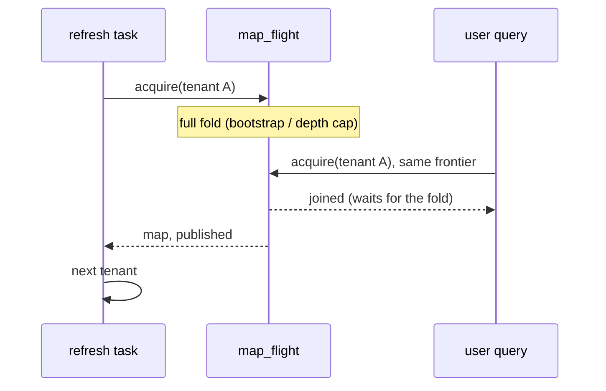

# RFC 0060 — Background template-map refresh

> **Status: `specified` (2026-10-13, #990, maintainer-approved: the
> RFC 0033 §4 reversal, the two telemetry names and the §7 decisions
> as recorded below; checked against the OpenTelemetry docs).** This RFC adds a querier
> background task on top of RFC 0033's acquisition path. It changes no
> artifact format, fold rule or publish rule of RFC 0033 (`accepted`), so
> it is a new RFC rather than an amendment. It **revisits** an
> alternative RFC 0033 §4 rejected, "a background refresher", on new
> evidence (§2.1). If this RFC is accepted, RFC 0033 §4 gets a dated
> pointer here.

## 1. Summary

The querier refreshes each tenant's template map in the background:
- once at start;
- then on a fixed interval;
- one tenant at a time;
- through the same per-tenant single-flight a query acquires through
  (`map_flight`).

The full folds that RFC 0033 still runs are paid by the background task
in most cases, not by a user query. These are the `no_fold_state`
bootstrap, the depth cap, and the `files_removed` / `out_of_order`
fallbacks. A query that arrives while the task is folding its tenant
joins that fold instead of starting a second one. The task never fails
the process, is bounded to one acquisition at a time, and is off when
configured off.

## 2. Motivation

RFC 0033's guarded incremental fold (§3.3 amendment 2026-10-12, #897)
made a stale refresh cheap. On the production node, over the first 24 h
of v0.13.0:
- 24 stale derives were incremental, p95 0.45 s;
- 2 derives were full folds: the one-time `no_fold_state` bootstrap, one
  per tenant;
- one of those took 49 s and 5,726 GETs, inside a user's
  `POST /v1/query`.

A querier restart is no longer cold: the artifact lives in the store, so
the first query after a restart is a hit or an incremental refresh.

Full folds still happen, and each lands on whichever query asks first:

- **Bootstrap.** The first acquisition after an artifact-format change
  (`no_fold_state`, `unknown_version`) or after a torn artifact.
- **Depth cap.** Every `INCREMENTAL_DEPTH_CAP` (256) *published*
  incremental steps (RFC 0033 §3.3). An abstained, failed or lost
  publish leaves the stored depth unchanged. If every one of the 24
  incremental derives a day observed above published, that is one cap
  fold per tenant per ten to eleven days. That is an upper bound on the
  frequency: each unpublished step makes the interval longer.
- **Fallbacks.** `files_removed` (audit objects removed, e.g. by
  retention) and `out_of_order`.

For a short-timeout client a 50 s fold is an outage: the client gives
up, the fold completes for the next query (`map_flight`), and the user
saw an error. This was the failure mode in #853. Moving that cost to a
task nobody waits on is cheaper than making every client patient.

### 2.1 Revisiting RFC 0033 §4

RFC 0033 §4 rejected a background refresher. Its reasoning was that the
refresher adds a scheduling component and a staleness-window policy
"for something the write-through gets for free at the moment of
demand". Two things have changed since:

- **The moment of demand is not free.** A full fold costs a user up to
  50 s, and since #897 every remaining full fold is one that some query
  pays for (above).
- **No staleness window is introduced.** The task only pays early. It
  calls the unchanged acquisition, whose frontier check still decides
  freshness for every query, so the RFC 0033 correctness argument is
  untouched. A query never reads a map older than its own listing.

What remains is the scheduling component, the cost this RFC proposes to
pay.

**Why this layer.** The querier already owns acquisition, single-flight
and publish. A separate process or the ingester would need its own copy
of all three and would compete with the querier's CAS publish. RFC 0033
§4 rejected ingester-side write-through for the same reasons (fold code
on the ingest path, publishing for tenants nobody queries).

## 3. Proposed design

### 3.1 The task

When the querier role starts, it spawns one tokio task, `template-map
refresh`. Each **pass**:

1. lists the tenants that have an audit stream, one delimited `LIST` of
   `audit/` taking the `tenant_id=` common prefixes, decoded with the
   partition key's tenant encoding (the inverse of
   `percent_encode_tenant`);
2. for each tenant, in listing order, calls the same
   `TemplateMapFlights::acquire_fetched` a query uses, and waits for it
   to finish before starting the next tenant.

The first pass starts immediately at role start. Each later pass starts
`interval` after the previous pass **finished**, so passes never
overlap. Nothing new is decided: a background acquisition takes the
usual path (a hit, an incremental fold, or a full fold), publishes
through the usual write-through, and is subject to every RFC 0033 rule.

### 3.2 Interaction with queries

The background acquisition is a flight like any other:
- a query for the same tenant and frontier joins it and records
  `joined`;
- a query at a different frontier waits for it and lists again
  (`map_flight` semantics).

So a query never runs a fold concurrently with the background task for
its tenant. A query that arrives during a 50 s background fold still
waits for the rest of it. The task narrows that window rather than
closing it: it only removes the case where the query is the first to
ask. §7 lists pre-emptive full folds as an open question.

### 3.3 Bounds

- **Concurrency.** One background acquisition at a time, for the whole
  process. Its peak memory is one fold's (the RFC 0058 / #853 bound),
  never a sum over tenants.
- **Shutdown.** The task stops at the next tenant boundary once
  shutdown begins. An acquisition already on the blocking pool runs to
  completion, as a dropped query's does (`map_flight`); shutdown does
  not wait for it.
- **Failure.** A failed acquisition is recorded (§3.5), and the pass
  moves on to the next tenant. A failed tenant listing ends the pass;
  the next pass retries. Neither failure stops the task or the process.
- **Cost on an idle tenant.** A tenant with a current artifact costs
  one audit `LIST` plus one artifact `GET` per pass (a hit). With the
  default interval that is negligible beside the ingest path's own
  requests. It is still paid per tenant, hence §7's question about
  large tenant counts.
- **Back-off when nothing persists.** An acquisition that ends without
  a publish and without a hit persists nothing. That covers a
  write-through abstention (RFC 0033 §3.2 size gate or ceiling, which
  may recur indefinitely), a failed publish, and a failed acquisition.
  Re-running it each pass would repeat the fold and its `GET`s every
  `interval` for no later query's benefit. So after `k` consecutive
  such acquisitions, the task skips that tenant for the next
  `min(2^k − 1, 11)` passes. The cap counts passes, not wall-clock
  time: at the default interval that is 11 × `interval` plus the
  skipped passes' own run time. A hit, a publish of its own, or a lost CAS race (someone
  else published) resets `k` to 0. The counter lives in process
  memory and resets on restart. A successful tenant listing drops the
  counters of tenants it no longer names, so the state follows the
  current tenants, not their history; a failed listing keeps them,
  since it names no current set. A query is never skipped: it acquires
  exactly as it does without the task.

### 3.4 Configuration

These keys sit under `querier.template_map.refresh.*` (RFC 0020;
`${env:…}` substitution as usual):

| key        | type     | default | meaning                                      |
|:-----------|:---------|:--------|:---------------------------------------------|
| `enabled`  | bool     | `true`  | spawn the task                               |
| `interval` | duration | `5m`    | idle time between passes; must be ≥ `10s`    |

`enabled: false` restores today's behaviour exactly. As with
`compaction.enabled` / `interval`, `interval` is parsed and validated
only when the task is enabled, so an unused bad value never blocks
startup. When enabled, an `interval` that is not a duration, or is
below the floor, is a startup configuration error naming the key. It
is not silently clamped, as RFC 0020 validates every other resolved
value.

### 3.5 Observability (CLAUDE.md §6.3)

- **Span.** Each pass is one root `INTERNAL` span, `refresh
  template_map`. It has no remote parent or child, so `INTERNAL` is the
  kind, and the name follows OTel's `{action} {target}` pattern beside
  `load template_map`. Each tenant's acquisition is the existing
  `load template_map` phase span, carrying `ourios.tenant`, with its
  CLIENT spans beneath it, nested under the pass as it nests under
  `POST /v1/query` today (RFC 0038 §3.7.2). Under the default
  `parentbased_always_on` sampler these roots are always sampled.
- **Errors** (OTel *Recording errors*). A tenant's failed acquisition
  sets error status and `error.type` on that tenant's
  `load template_map` span. The pass handled it and continued, so the
  pass span and the pass sample carry no error for it. Only a pass
  that ends early (a failed tenant listing) sets `error.type`, on both
  the pass span and its `refresh.duration` sample, with the same value.
  So the span and its duration metric describe the same operation, as
  OTel recommends.
- **Metrics.** The RFC 0033 lookup and derive instruments gain one
  attribute, `ourios.template_map.acquire.trigger` = `query` |
  `refresh`. This splits the existing series so a dashboard can tell a
  fold a user paid for from one the task paid for. The criterion of
  this RFC is that `query`-triggered full folds approach zero.
- **Pass.** One histogram, `ourios.template_map.refresh.duration` (s),
  one sample per pass, named per OTel's `{operation}.duration` rule.
  Tenants and tenant counts are not attributes: OTel's cardinality
  guidance keeps ID-like values off metrics, and they are on the spans.

`ourios.template_map.acquire.trigger` follows the precedent of the
upstream `faas.trigger` ("type of the trigger which caused this
invocation"). Its own values (`query`, `refresh`) are more precise here
than `faas.trigger`'s `http` / `timer`: a query can arrive over HTTP or
MCP, and the start pass is not a timer. With two values it at most
doubles the existing series.

`ourios.template_map.acquire.trigger` and
`ourios.template_map.refresh.duration` are new names, registered in
ourios-semconv `v0.3.17` under the purpose-check and
maintainer-approval rule, after an OTel naming-guidance check.

### 3.6 Multi-tenancy and replicas (CLAUDE.md §3.7)

Each acquisition is per tenant, as today. Several querier replicas each
run their own task. Their publishes are CAS writes, so the worst case
is duplicated fold work, never a torn or regressed artifact (RFC 0033
§3.4). Coordinating replicas is out of scope (§7).

## 4. Alternatives considered

**Warm only at start.** Same task, one pass, no interval. Simpler, but
since #897 a restart is not the cold case: the artifact survives in the
store. The depth-cap and fallback full folds still land on queries.
Rejected as covering only the case that has already been fixed.

**Pre-emptive full fold before the depth cap.** The task would fold in
full when a tenant's depth nears the cap, so the cap is never reached
on the query path. This needs a new rule in RFC 0033's derive policy
(fold in full below the cap, but only off the query path). Deferred to
§7 so the task lands first and Dash0 can show whether cap folds still
reach queries.

**Serve stale while revalidating.** Answer a query from the stale
artifact and fold in the background. This breaks RFC 0033's guarantee
that a query renders against a map at its own frontier: rows written
after the artifact would render against missing or old bindings
(CLAUDE.md §3.3). Rejected.

**Raise client timeouts.** Not ours to control, and it hides a 50 s fold
instead of removing it from the request.

**Fold in the ingester.** See §2: the ingester does not own the read
path, and a second publisher contends for the CAS.

## 5. Acceptance criteria

> **Scenario RFC0060.1 — A start pass absorbs the bootstrap**
> - **Given** a store whose tenant has an artifact without `fold_state`,
>   and a folded map the write-through publishes (not abstained, no
>   IO error)
> - **When** the querier starts with refresh enabled, and a query
>   arrives after the first pass has finished
> - **Then** the full fold ran with `acquire.trigger = refresh`
> - **And** the query's lookup is a `hit` with
>   `acquire.trigger = query`, and runs no fold.

> **Scenario RFC0060.2 — A query during a background fold joins it**
> - **Given** the task holding a tenant's flight on a gated fold
> - **When** a query for that tenant at the same frontier arrives
> - **Then** exactly one fold runs, and the query records `joined` and
>   receives the task's map
> - **And** the query's `joined` lookup carries
>   `acquire.trigger = refresh`: the attribute names who initiated the
>   shared acquisition, not who recorded the sample.

> **Scenario RFC0060.3 — One background acquisition at a time**
> - **Given** three tenants, each with a gated fold
> - **When** a pass runs
> - **Then** at most one background acquisition is in flight at any
>   instant, and the tenants are visited in listing order.

> **Scenario RFC0060.4 — Failure is contained**
> - **Given** two tenants, the first with an unreadable audit object
> - **When** a pass runs
> - **Then** the first tenant's `load template_map` span carries error
>   status and `error.type`
> - **And** the second tenant is still acquired, under the same pass span
> - **And** the pass span and its `refresh.duration` sample carry no
>   `error.type`, and the task runs its next pass
> - **And** a pass whose tenant listing fails ends early with the same
>   `error.type` on its span and its sample.

> **Scenario RFC0060.5 — Disabled means today's behaviour**
> - **Given** `querier.template_map.refresh.enabled: false`
> - **When** the querier starts and idles past `interval`
> - **Then** no acquisition runs, and no `refresh template_map` span or
>   refresh sample is emitted.

> **Scenario RFC0060.6 — Configuration is validated**
> - **Given** refresh enabled with `interval: 1s`, or a non-duration
>   value
> - **When** the configuration is resolved
> - **Then** startup fails with an error naming the key
> - **And** with `enabled: false` the same values resolve without
>   error.

> **Scenario RFC0060.7 — Shutdown is prompt**
> - **Given** a pass between tenants, or waiting on its interval
> - **When** the querier shuts down
> - **Then** the task exits without starting another acquisition
> - **And given** a pass whose acquisition is on the blocking pool,
>   gated, **when** the querier shuts down, **then** the task exits
>   without waiting for the gate, and once the gate is released the
>   flight still completes and publishes (it is not cancelled).

> **Scenario RFC0060.8 — Telemetry is registry-conformant**
> - **Given** RFC0060.1's run
> - **When** its spans and metrics are exported
> - **Then** the pass is one root `INTERNAL` span named
>   `refresh template_map`, with each tenant's `load template_map`
>   span beneath it, asserted through the in-memory span exporter
>   (span names are not registry entries)
> - **And** `acquire.trigger` and `refresh.duration` pass weaver
>   live-check against the ourios-semconv registry.

> **Scenario RFC0060.9 — Query-paid full folds drop** (Dash0, after
> deploy)
> - **Given** the node on the release that ships this RFC, and the
>   previous release, each over a 7-day window
> - **When** full folds are counted, normalised per tenant-day
> - **Then** `derive.duration{mode=full, acquire.trigger=query}` on
>   the new release is below the previous release's `mode=full` count.
>   A query that joins a background fold records no derive of its own,
>   so the remaining `query` full folds are those where a query became
>   the acquirer before the pass reached its tenant.

> **Scenario RFC0060.10 — A tenant that persists nothing is backed off**
> - **Given** a tenant whose write-through abstains on every acquisition
> - **When** consecutive passes run
> - **Then** the task acquires it on passes 1, 3 and 7 (skipping 1,
>   then 3), and on no more than one pass in 12 thereafter
> - **And** a query for that tenant still acquires on every request
> - **And** after a hit or a publish the tenant is acquired on the next
>   pass again
> - **And** once a successful listing no longer names the tenant, its
>   counter is dropped; a failed listing drops nothing.

> **Scenario RFC0060.11 — Passes are spaced from their end, never overlap**
> - **Given** paused time, `interval: 5m`, and a pass whose fold is
>   gated for longer than `interval`
> - **When** the gate is released
> - **Then** no second pass starts while the first is running, and the
>   next pass starts `interval` after the first pass finished, with no
>   catch-up pass in between.

## 6. Testing strategy

- RFC0060.1–.4, .7, .10 and .11 are integration tests (RFC0060.11
  under tokio paused time) in `ourios-querier` over a
  local store, using the `map_flight` hooks (`before_acquire` gating,
  acquisition and join counters) through the `testing` feature.
- RFC0060.5–.6 are `ourios-server` config tests (RFC 0020 style) plus
  one served-role test.
- RFC0060.8 asserts span names and nesting through the in-memory span
  exporter, and the registry names through the weaver live-check
  harness (`live_check`).
- RFC0060.9 is a Dash0 before/after measurement recorded on the release
  (the RFC0033.14 precedent), not a CI test.

No `proptest` or corpus test applies: the task adds scheduling, not
fold semantics, and the fold's own property tests (RFC0033.10–.13)
already cover what it calls.

## 7. Open questions

Decided for this RFC (maintainer, 2026-10-13); each is revisited only on
the Dash0 evidence named:

- [x] **Pre-emptive full fold near `INCREMENTAL_DEPTH_CAP`: deferred.**
      Cap folds come at most once per 256 published incremental steps
      per tenant (about ten days at the observed rate if every step
      published, rarer otherwise), so a 5-minute pass almost always
      reaches them first. Reopen, as an RFC 0033 derive-policy
      amendment, if `derive.duration{mode=full, acquire.trigger=query}`
      stays above zero after RFC0060.9.
- [x] **Large tenant counts: not in v1.** Every tenant is visited each
      pass. The preferred later shape is to refresh only tenants queried
      within a window. Reopen when `refresh.duration` approaches
      `interval`.
- [x] **Replicas: accept duplicated folds.** CAS publish keeps them
      correct (§3.6). A CAS lease object for a single refresher is the
      later shape, when replicas are deployed.
- [x] **Default `interval`: `5m`.** Revisit with publish and fold rates
      after release.

## 8. References

- RFC 0033 (cached template map): §3.3 freshness and the incremental
  fold, §3.4 CAS publish, §3.5 write-through, §3.7 instruments, §4 (the
  background refresher and ingester write-through alternatives).
- RFC 0038 §3.7 (query-phase spans), RFC 0020 (configuration), RFC 0005
  (partition layout), RFC 0058 (query resource limits).
- #853 (cold map / RSS), #897 (incremental fold), #934 (resumable
  bootstrap), #990 (this RFC's issue).
- CLAUDE.md §3.3, §3.7, §6.3.
